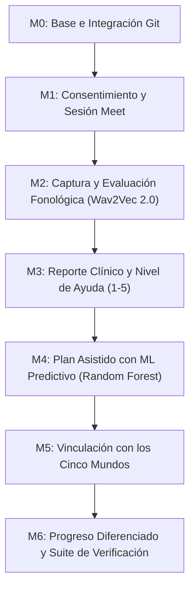

# Desglose Modular y Plan de Implementación de Ashakids

> **Plan Técnico Integrado: Inteligencia Artificial Dual y Supervisión Clínica (Human-in-the-Loop)**
> *Versión 2.0 • 2 de noviembre de 2026*
> *Alineado con las directrices de `AGENTS.md` (Reglas 1 a 4)*

---

## 1. Resumen Ejecutivo

El plan de Ashakids integra **transcripción experimental con Wav2Vec 2.0** y prepara una segunda capacidad predictiva bajo **supervisión clínica humana**. La transcripción está disponible como apoyo preliminar; el predictor terapéutico permanece cerrado hasta contar con un artefacto y una validación clínica aprobados.

1. **Deep Learning Acústico (Wav2Vec 2.0)**: Procesamiento de muestras breves de audio (2 a 3 segundos) para producir una transcripción tentativa que el especialista revisa. El sistema no puntúa pronunciación, no calcula similitud fonética validada ni emite diagnósticos.
2. **Machine Learning Predictivo Supervisado (Random Forest / Scikit-Learn)**: El contrato y la integración para estimar sesiones y riesgo de deserción están preparados, pero el servicio rechaza el pronóstico mientras no se instale un paquete clínico aprobado. En ese estado el terapeuta registra el plan manualmente; no se genera una predicción ni se sustituye por el valor fijo de 12 sesiones.
3. **Privacidad y Consentimiento Estricto (Ley 29733 / HIPAA)**: Consentimiento informado del tutor previo a la captura de audio, destrucción inmediata de grabaciones de voz en la memoria RAM y estricta separación entre analítica clínica formal y puntajes lúdicos de los cinco mundos.

---

## 2. Módulos de Trabajo y Límites de Responsabilidad



| Módulo | Alcance, Trabajo y Entregables | Dependencias |
| :--- | :--- | :---: |
| **M0 — Base e Integración** | • Mantener `feat/sroman` alineada con `origin/dev` antes de integrar cambios.<br>• Mantener cerrada el alta pública de familias: el personal administrador crea las cuentas manualmente y envía un enlace temporal de activación; las pantallas públicas solo explican cómo solicitar acceso.<br>• Mantener `AGENTS.md` y configuración unificada de Google Meet (creación automática si está configurado y soporte manual alternativo).<br>• Ejecutar las suites backend, E2E, frontend, arquitectura, ML, typecheck y build descritas en `AGENTS.md`; los conteos se obtienen de cada ejecución y no se fijan en el plan. | Primero |
| **M1 — Consentimiento y Sesión** | • **Consentimiento del Tutor**: Modal y registro en base de datos de autorización expresa y revocable para uso de IA acústica antes de iniciar la primera cita.<br>• **Control Temporal de Cita**: Alerta a $T-10\text{ min}$, botón *"Iniciar reunión"* a $T-5\text{ min}$ y apertura a $T=0$.<br>• **Apertura Dual**: Despliegue en pestañas sincronizadas de Google Meet y del Panel de Sesión Activa de Ashakids.<br>• **Cierre Explícito**: La sesión queda `FINALIZADA` (y la reserva `COMPLETADA`) únicamente cuando el terapeuta confirma el cierre en pantalla. | M0 |
| **M2 — Captura y Fonología (Wav2Vec 2.0)** | • **Widget Clínico**: Selector de fonemas (/rr/, /r/, /s/, /pl/, /tr/) y palabras objetivo (*carro*, *ratón*, *plato*).<br>• **Captura Controlada**: Ventana de 2 a 3 segundos desde el micrófono local, enviando paquetes cada 250ms.<br>• **Inferencia Acústica Local**: Endpoint `/predict/phonetics` en `ml-service` (puerto 8001). Entrega transcripción tentativa, objetivo y estado de revisión; no calcula similitud ni diagnóstico.<br>• **Privacidad de Voz**: El audio se destruye de la memoria RAM inmediatamente tras la inferencia; no se almacenan audios infantiles en disco.<br>• **Etiqueta Clínica**: Se presenta como *"Transcripción automática preliminar; requiere revisión del terapeuta"*. | M1 |
| **M3 — Resultados y Reporte Clínico** | • **Inserción Asistida**: Botón *"Pegar en el informe"* que traslada la transcripción acústica y fonema evaluado al campo de observaciones.<br>• **Revisión Obligatoria**: El terapeuta puede editar, complementar o descartar cualquier texto sugerido.<br>• **Nivel de Ayuda Estandarizado**: Registro formal del soporte requerido por el menor en escala 1 (autónomo) a 5 (ayuda continua).<br>• **Emisión**: Guardado en borrador, firma profesional y generación de reporte PDF para los padres. | M2 |
| **M4 — Plan con ML Predictivo** | • **Integración preparada, predictor cerrado**: `ml-service` solo calcula sesiones y riesgo cuando carga un artefacto aprobado con manifiesto, hashes e informe de validación verificables. Hoy responde no disponible (HTTP 503); el terapeuta puede completar el plan manualmente y no se usa un valor fijo de 12.<br>• **Variables de Entrada (Features)**: Edad del niño, código diagnóstico revisado, cantidad de fonemas confirmados, nivel de colaboración guardado y frecuencia semanal.<br>• **Salidas esperadas tras aprobación**: Sesiones estimadas y rango, riesgo de deserción (*Bajo*, *Medio*, *Alto*) y probabilidad calibrada. Cifras ilustrativas como $14.2 \pm 2$ o *88%* no son resultados actuales del sistema.<br>• **Control Clínico**: Cuando exista un modelo aprobado, la propuesta requerirá confirmación o ajuste manual del terapeuta antes de publicar. | M2 y M3 |
| **M5 — Mundos y Juegos** | • **Reutilización de Esquemas**: Se reutilizan las tablas relacionales vigentes `actividades`, `mundos`, `niveles` y `resultados_nivel`; **no se duplican tablas de progreso**.<br>• **Mapeo Fonético Lúdico**: Al priorizar fonemas, se asignan y destacan niveles tanto en `HABLA` (Taller de los Sonidos / Isla Mágica) como en `LENGUAJE` (La Isla de las Palabras y el Laberinto).<br>• **Portal Familiar**: Insignia dorada *"Juegos recomendados por tu terapeuta para esta semana"* en el Centro Familiar. | M4 |
| **M6 — Seguimiento y Verificación** | • **Analítica Diferenciada**: Gráfica clínica de fonemas superados vs. barra de práctica lúdica en casa (regla de oro: nunca promediar notas de juego con diagnósticos).<br>• **Comparativa Real vs. Modelo**: Comparación de sesiones tomadas frente al plan confirmado por el terapeuta.<br>• **Batería de Pruebas y Cierre**: Ejecución del 100% de la suite de pruebas requeridas por `AGENTS.md` y apertura de PR formal a `dev`. | M3 y M5 |

---

## 3. Contratos de API y Límites de Datos

1. **Endpoint de Inferencia Acústica (`POST /api/v1/sesiones/:id/evaluacion-fonema`)**:
   - Proxy seguro hacia `http://127.0.0.1:8001/predict/phonetics`.
   - Payload: FormData con archivo WAV mono 16 kHz y palabra objetivo.
   - Retorno: `{ id_evaluacion: number, estado: 'PENDIENTE_REVISION', palabra_esperada: string, transcripcion_tentativa: string, duracion_segundos: number, aviso: string }`.
   - Política: El audio no se persiste en base de datos ni almacenamiento de objetos (solo métricas en RAM/DB).

2. **Endpoint de Pronóstico de Plan (`POST /api/v1/clinica/tratamientos/predecir-plan`)**:
   - La interfaz envía `{ id_sesion: number, codigo_diagnostico: number, frecuencia_semanal: number }`; no puede sustituir datos clínicos de entrada.
   - El backend verifica acceso y estado de la sesión, y deriva la edad del perfil, los fonemas de evaluaciones confirmadas y la colaboración del informe guardado. La predicción queda vinculada a esa sesión.
   - El backend envía al servicio ML el vector derivado `{ edad_meses: number, codigo_diagnostico: number, cantidad_fonemas_afectados: number, nivel_colaboracion: number, frecuencia_semanal: number }`.
   - Retorno: `{ sesiones_estimadas: number, rango_min: number, rango_max: number, riesgo_desercion: 'BAJO'|'MEDIO'|'ALTO', confianza: number }`.
   - Política: Actúa como recomendación de apoyo. El backend exige confirmación humana antes de crear o actualizar el registro en la tabla `tratamientos`.

### Límite de validación clínica

La regla 1 de `AGENTS.md` prevalece sobre cualquier versión previa de este plan: Wav2Vec entrega únicamente transcripción tentativa y metadatos de la muestra. No se genera similitud fonética, calificación de pronunciación ni diagnóstico automático. Para activar el predictor terapéutico se exige un artefacto aprobado, cohorte independiente, catálogo diagnóstico institucional revisado y expediente de validación verificable. El repositorio no incluye esos insumos; por ello el pronóstico permanece cerrado y se permite completar el plan manualmente.

3. **Separación de Métricas Lúdicas y Clínicas**:
   - Los datos de los 5 mundos registran duración, aciertos y niveles superados en el hogar.
   - No alteran diagnósticos clínicos ni sobreescriben reportes firmados.

---

## 4. Flujo de Trabajo en Git (Desarrollo Ágil y Limpio)

Para evitar la fricción y bloqueos de archivos de múltiples worktrees en Windows:
- Todo el trabajo se organiza en **ramas temáticas de funcionalidad** (`feat/sesion-meet-ia`) creadas desde `dev`.
- Cada módulo se verifica con la batería obligatoria antes de fusionar:
  ```bash
  # 1. Pruebas de integración del backend
  npm --prefix backend run test

  # 2. Pruebas de enrutamiento y guardias
  npm --prefix frontend run test:routing

  # 3. Límite de 500 líneas y cliente HTTP centralizado
  npm --prefix frontend run check:frontend

  # 4. Pruebas de componentes frontend
  npm --prefix frontend run test:components

  # 5. Compilación de producción
  npm --prefix frontend run build
  ```
- Nomenclatura oficial de commits y PRs según **Regla 3 de `AGENTS.md`**:
  `V<Número>_<Descripción_Camel_Case_O_Con_Guiones_Bajos>`

---

## 5. Resumen del Cronograma de Ejecución

| Hito | Nombre del Módulo | Foco Principal | Duración Estimada |
| :---: | :--- | :--- | :---: |
| **M0** | Base e Integración | Congelación de contratos y sincronización con `dev` | 1 día |
| **M1** | Consentimiento y Sesión Meet | Consentimiento legal digital y apertura dual de Google Meet | 2 días |
| **M2** | Audio Fonológico en Vivo | Widget de captura de micrófono y Wav2Vec 2.0 en puerto 8001 | 3 días |
| **M3** | Reporte Estructurado | Editor de informes con nivel de ayuda (1-5) y firma en PDF | 2 días |
| **M4** | Plan con ML Predictivo | Random Forest en `ml-service` y tarjeta interactiva en el plan | 3 días |
| **M5** | Conexión con 5 Mundos | Asignación de fonemas a los juegos y recomendación en portal | 2 días |
| **M6** | Dashboard y Cierre CI/CD | Analítica diferenciada, suite completa de tests y PR final | 2 días |

---
*Este documento reemplaza cualquier versión preliminar y constituye la guía oficial de implementación.*
