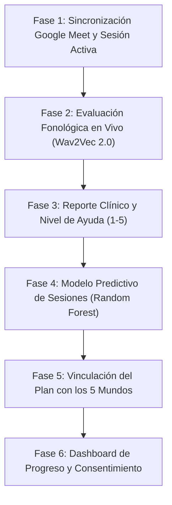

# Ashakids | Desglose de Tareas de Implementación

## Plan de Automatización, Evaluación Fonológica con IA y Pronóstico Terapéutico Predictivo

> **Backlog Técnico de Ejecución por Fases e Hitos**  
> *Versión 1.0 • 2 de noviembre de 2026*  
> *Alineado con las directrices de `AGENTS.md` (Reglas 1 a 4)*

---

## Estructura General del Plan de Trabajo

---

## Fase 1: Panel de Sesión en Vivo y Sincronización con Google Meet
*Objetivo: Lograr que la atención virtual corra fluida con Google Meet en paralelo al panel clínico de Ashakids.*

### Tarea 1.1: Cronograma Temporal y Estados de Cita
- **Descripción**: Implementar la lógica temporal en frontend y backend: alerta al terapeuta a $T-10\text{ min}$, habilitación del botón *"Iniciar reunión"* a $T-5\text{ min}$ y apertura a $T=0$.
- **Archivos a modificar**:
  - `frontend/src/shared/presentation/components/common/OperationalDashboard.tsx`
  - `frontend/src/shared/presentation/components/common/VirtualMeeting.tsx`
  - `backend/src/modules/citas/citas.service.ts`
- **Criterio de Aceptación**: El botón se activa únicamente en la ventana permitida y no permite acceso fuera de horario sin cita confirmada.

### Tarea 1.2: Apertura Dual Sincronizada
- **Descripción**: Al hacer clic en *"Iniciar reunión"*, el sistema debe:
  1. Abrir la sala de Google Meet en una pestaña (`meet_url`).
  2. Abrir o transicionar al **Panel de Sesión Activa** en Ashakids con los datos del paciente.
- **Archivos a modificar**:
  - `frontend/src/modules/terapeuta/presentation/TerapeutaAgenda.tsx`
  - `frontend/src/shared/presentation/components/common/SessionActions.tsx`
- **Criterio de Aceptación**: Ambos accesos se despliegan limpiamente sin bloqueos de pop-up en el navegador.

### Tarea 1.3: Cierre Confirmado por el Terapeuta
- **Descripción**: La sesión solo cambia a estado `REALIZADA` cuando el terapeuta pulsa explícitamente *"Finalizar sesión"*, evitando desconexiones involuntarias si se extiende unos minutos de los 40 min estándar.
- **Archivos a modificar**:
  - `backend/src/modules/sesiones/sesiones.service.ts`
  - `frontend/src/shared/presentation/components/common/SessionActions.tsx`
- **Criterio de Aceptación**: El estado en la tabla `reservas` pasa a `REALIZADA` y redirige al terapeuta directamente a la redacción del reporte.

---

## Fase 2: Evaluación Fonológica Acústica en Tiempo Real (Wav2Vec 2.0)
*Objetivo: Permitir al terapeuta testear fonemas en vivo en 2 segundos y registrar los fonemas afectados de forma objetiva.*

### Tarea 2.1: Microservicio ML y Endpoint de Inferencia
- **Descripción**: Asegurar el endpoint `/predict/phonetics` en `ml-service` (FastAPI) y su ruta proxy en backend Express `/api/v1/sesiones/:id/evaluacion-fonema`.
- **Archivos a modificar**:
  - `ml-service/app.py`
  - `backend/src/modules/sesiones/sesiones.routes.ts`
  - `backend/src/modules/sesiones/sesiones.service.ts`
- **Criterio de Aceptación**: Procesa muestras WAV de 2 a 3 segundos y responde en $<1.5\text{ s}$ con transcripción acústica, similitud (%) y diagnóstico preliminar (ej. lambdacismo).

### Tarea 2.2: Widget UI de Captura Rápida en el Panel de Sesión
- **Descripción**: Componente con selector de fonemas (/r/, /rr/, /s/, /pl/, /tr/) y palabras objetivo (*carro*, *ratón*, *plato*), botón de grabación con animación de onda y visualización inmediata del resultado.
- **Archivos a modificar**:
  - `frontend/src/shared/presentation/components/common/TherapistVoiceAIWidget.tsx`
  - `frontend/src/shared/application/audio/audioRecorderToWav.ts`
- **Criterio de Aceptación**: Graba con el micrófono local enviando paquetes cada 250ms, maneja estados de carga sin congelar la interfaz y muestra feedback visual amigable.

### Tarea 2.3: Persistencia de Evaluaciones Fonológicas de la Sesión
- **Descripción**: Crear la tabla `evaluaciones_fonologicas_sesion` en PostgreSQL para registrar cada intento sin guardar el audio en disco (privacidad estricta).
- **Campos**: `id_evaluacion`, `id_reserva`, `id_paciente`, `fonema_evaluado`, `palabra_objetivo`, `transcripcion_obtenida`, `porcentaje_similitud`, `es_correcto`, `fecha_registro`.
- **Archivos a modificar**:
  - `backend/src/modules/sesiones/` (migración SQL y servicio)
  - `docker/init.sql`
- **Criterio de Aceptación**: Cada prueba exitosa queda indexada y lista para ser consumida por el reporte.

---

## Fase 3: Integración del Reporte Clínico y Nivel de Ayuda (1 al 5)
*Objetivo: Automatizar el llenado del informe clínico eliminando la reescritura manual de resultados.*

### Tarea 3.1: Traspaso de Fonemas Evaluados al Reporte ("Pegar en el informe")
- **Descripción**: El editor clínico recupera las evaluaciones fonológicas realizadas en la sesión activa y permite insertarlas automáticamente en el campo de *Observaciones*.
- **Archivos a modificar**:
  - `frontend/src/shared/presentation/components/common/ClinicalReportEditor.tsx`
  - `frontend/src/modules/terapeuta/presentation/TerapeutaReportes.tsx`
- **Criterio de Aceptación**: Con 1 clic en *"Pegar en el informe"*, el texto técnico estandarizado se redacta en las notas de evolución.

### Tarea 3.2: Registro Estandarizado de la Escala de Ayuda (1 a 5)
- **Descripción**: Mantener el selector visual del nivel de asistencia que necesitó el menor (Nivel 1: Autónomo $\rightarrow$ Nivel 5: Ayuda física / verbal continua) y persistirlo en el reporte.
- **Archivos a modificar**:
  - `frontend/src/shared/presentation/components/common/ReportHelpLevel.tsx`
  - `backend/src/modules/sesiones/sesiones.service.ts`
- **Criterio de Aceptación**: El valor de ayuda queda registrado como dato estructurado para alimentar el modelo predictivo de la Fase 4.

### Tarea 3.3: Firma y Emisión del PDF Clínico
- **Descripción**: Guardado en borrador, validación profesional con firma del especialista y generación del reporte descargable para los padres.
- **Archivos a modificar**:
  - `frontend/src/shared/presentation/components/common/ReportDownload.tsx`
- **Criterio de Aceptación**: Genera el PDF con membrete oficial ASHA, datos del paciente y diagnóstico firmado.

---

## Fase 4: Modelo Predictivo de Sesiones y Riesgo de Deserción (ML Tabular)
*Objetivo: Eliminar el valor estático `sesiones: 12` en la Consulta Introductoria mediante un modelo supervisado (Random Forest).*

### Tarea 4.1: Modelo Supervisado de Random Forest en Python
- **Descripción**: Crear el script de entrenamiento y serialización (`predictive_model.joblib`) en `ml-service/`.
- **Features de Entrada**:
  - `edad_meses`: Edad del niño.
  - `codigo_diagnostico`: Dislalia (0), Retraso del habla (1), TEL (2), Deglución atípica (3).
  - `cantidad_fonemas_afectados`: Entero obtenido de las pruebas de Wav2Vec 2.0 (Fase 2).
  - `nivel_colaboracion`: Entero 1 a 5 (inverso al nivel de ayuda de la Fase 3).
  - `frecuencia_semanal`: 1 o 2 sesiones/semana.
- **Targets Predichos**:
  - `sesiones_estimadas`: Regresión continua (ej. 14.2 $\rightarrow$ 14 sesiones).
  - `riesgo_desercion`: Clasificación (`BAJO`, `MEDIO`, `ALTO`) con porcentaje de confianza.
- **Archivos a crear**:
  - `ml-service/train_predictive_model.py`
  - `ml-service/models/treatment_predictor.joblib`

### Tarea 4.2: Endpoint FastAPI `/predict/treatment-plan`
- **Descripción**: Exponer la inferencia tabular en el microservicio FastAPI en el puerto 8001.
- **Archivos a modificar**:
  - `ml-service/app.py`
  - `ml-service/test_api.py`
- **Criterio de Aceptación**: Responde en $<10\text{ ms}$ con `{ sesiones_estimadas: 14, rango_min: 13, rango_max: 16, riesgo_desercion: "BAJO", confianza: 0.88 }`.

### Tarea 4.3: Conexión con Backend y Pantalla del Plan Asistido (`SessionPlan.tsx`)
- **Descripción**: En la Consulta Introductoria, la pantalla del plan consulta el modelo predictivo y despliega la tarjeta de sugerencia inteligente con opción de *"Aceptar propuesta (1 clic)"* o modificar manualmente.
- **Archivos a modificar**:
  - `backend/src/modules/clinica/services/`
  - `frontend/src/shared/presentation/components/common/SessionPlan.tsx`
- **Criterio de Aceptación**: Desaparece el valor quemado de 12; el plan se inicializa con el pronóstico del modelo y queda sujeto a confirmación del terapeuta.

---

## Fase 5: Integración del Plan Terapéutico con los Cinco Mundos
*Objetivo: Trasladar los fonemas y objetivos del plan aprobado a las actividades lúdicas del menor.*

### Tarea 5.1: Matriz de Asignación Fonema $\leftrightarrow$ Actividad
- **Descripción**: Crear el catálogo que mapea cada fonema objetivo con juegos específicos:
  - Fonemas vibrantes `/r/`, `/rr/` $\rightarrow$ Niveles del *Laberinto de Palabras* y *Isla Mágica*.
  - Fonemas fricativos `/s/`, `/z/` $\rightarrow$ *Canciones y Rimas*.
  - Sinfones `/pl/`, `/bl/`, `/tr/` $\rightarrow$ *Adivinanzas* y *Cuentos Interactivos*.
- **Archivos a modificar**:
  - `backend/src/modules/mundo_asha/services/`
  - `frontend/src/shared/domain/`

### Tarea 5.2: Señalización Visual en el Portal del Padre
- **Descripción**: Mostrar en el Centro Familiar (`FamilyWorlds.tsx`) una insignia de *"Recomendado por tu terapeuta"* en los mundos priorizados por el plan activo del niño.
- **Archivos a modificar**:
  - `frontend/src/modules/padre/presentation/dashboard/FamilyWorlds.tsx`
  - `frontend/src/modules/padre/presentation/dashboard/FamilyCenter.tsx`
- **Criterio de Aceptación**: La familia visualiza claramente qué juegos debe reforzar esta semana según la indicación del especialista.

### Tarea 5.3: Registro de Métricas de Participación en Casa
- **Descripción**: Registrar tiempo de juego, intentos y aciertos en la tabla `actividad_ludica_paciente`.
- **Archivos a modificar**:
  - `backend/src/modules/mundo_asha/`
- **Criterio de Aceptación**: Guarda la constancia de juego sin mezclar puntajes lúdicos con evaluaciones clínicas formales.

---

## Fase 6: Dashboard de Progreso Diferenciado, Seguridad y Cierre
*Objetivo: Presentar la evolución clínica comparando el pronóstico vs. sesiones reales y garantizar la privacidad de los menores.*

### Tarea 6.1: Analíticas Clínicas vs. Analíticas Lúdicas
- **Descripción**: En `TerapeutaAnaliticas.tsx` y `FamilyTrackingPanel.tsx`:
  - **Gráfico 1 (Clínico)**: Curva de superación fonológica por sesión y barra de avance de sesiones realizadas vs. proyectadas por el modelo (ej. *Sesión 4 de 14*).
  - **Gráfico 2 (Lúdico)**: Frecuencia de práctica en el hogar en los 5 mundos.
- **Archivos a modificar**:
  - `frontend/src/modules/terapeuta/presentation/TerapeutaAnaliticas.tsx`
  - `frontend/src/shared/presentation/components/common/FamilyTrackingPanel.tsx`

### Tarea 6.2: Consentimiento Informado Digital de Menores
- **Descripción**: Modal y registro de aceptación de los términos de protección de datos (Ley 29733) y uso de IA acústica antes de la primera sesión introductoria.
- **Archivos a modificar**:
  - `frontend/src/modules/padre/presentation/`
  - `backend/src/modules/pacientes/`

### Tarea 6.3: Batería de Pruebas Automatizadas y CI/CD
- **Descripción**: Ejecutar y garantizar el 100% de éxito en:
  1. `npm --prefix backend run test` (pruebas de integración).
  2. `npm --prefix frontend run test:routing` (guardias de rol y rutas).
  3. `npm --prefix frontend run test:components` (435 pruebas unitarias).
  4. `npm --prefix frontend run check:frontend` (límite 500 líneas y HTTP client).
  5. `npm --prefix frontend run build` (compilación limpia Vite).
- **Commit y PR**: Según convención oficial de `AGENTS.md`.

---

## Resumen del Cronograma de Implementación

| Fase | Hito Clave | Complejidad | Dependencias |
| :---: | :--- | :---: | :--- |
| **Fase 1** | Panel de Sesión Meet + Temporizadores | Media | Ninguna (base existente) |
| **Fase 2** | Pruebas Fonológicas en Vivo (Wav2Vec 2.0) | Media-Alta | Fase 1 |
| **Fase 3** | Reporte Clínico Estructurado + Ayuda (1-5) | Media | Fase 2 |
| **Fase 4** | **Modelo Predictivo de Sesiones (Random Forest)** | **Media** | **Fases 2 y 3 (usa sus datos)** |
| **Fase 5** | Conexión del Plan con los 5 Mundos | Media | Fase 4 |
| **Fase 6** | Dashboard de Progreso + Consentimiento + CI | Media | Fase 5 |

---
*Documento de trabajo técnico listo para ejecución.*

