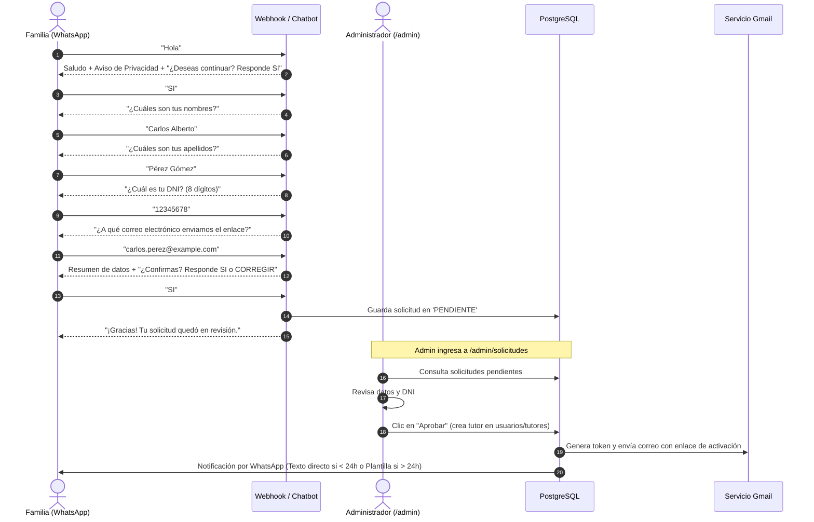

# Guía de Configuración e Integración de WhatsApp Real con Meta Cloud API

Esta guía detalla paso a paso cómo configurar, conectar y operar el chatbot de WhatsApp de **Ashakids** utilizando la **Meta Cloud API (WhatsApp Business Platform)**.

Está orientada a cualquier miembro del equipo que deba configurar la integración desde cero en la consola de [Meta for Developers](https://developers.facebook.com/) y ponerla en funcionamiento tanto en entornos de desarrollo local como en el despliegue de producción sobre AWS EC2.

---

## 1. Qué hace el Chatbot y qué NO hace

Para garantizar la seguridad, el cumplimiento de la privacidad y la integridad médica/administrativa de la plataforma:

### ✅ Qué SÍ hace:
- **Atención inicial automatizada**: Saluda a los postulantes cuando escriben al número oficial de WhatsApp.
- **Aviso de privacidad y consentimiento explícito**: Informa qué datos se solicitan (nombres, apellidos, DNI, correo y teléfono) y exige la aceptación explícita (`SI`) para continuar.
- **Recolección guiada de datos familiares**: Pide paso a paso los nombres del tutor, apellidos, DNI (8 dígitos peruanos) y correo electrónico.
- **Confirmación antes de enviar**: Muestra un resumen de los datos recolectados y permite al usuario confirmar (`SI`) o reiniciar (`CORREGIR`).
- **Registro de solicitud**: Al confirmar, guarda un registro en la tabla `solicitudes_acceso_familia` con estado inicial `PENDIENTE`.
- **Derecho al olvido inmediato (`CANCELAR`)**: En cualquier momento antes de que la solicitud sea tomada por un administrador, el usuario puede enviar la palabra `CANCELAR`. El sistema elimina automáticamente la solicitud `PENDIENTE` y borra de la base de datos los datos recolectados.
- **Aviso de estado si vuelve a escribir**: Si una familia con solicitud abierta o ya aprobada vuelve a escribir, el bot le informa que su solicitud está en revisión o ya fue aprobada, evitando duplicados.

### ❌ Qué NO hace:
- **NO crea cuentas de usuario automáticamente**: El bot nunca inserta registros en la tabla de usuarios ni genera credenciales de acceso.
- **NO otorga acceso clínico ni familiar**: La cuenta de tutor (`PADRE`) solo se crea cuando un Administrador revisa manualmente la solicitud en el panel web (`/admin/solicitudes`) y hace clic en **«Aprobar»** (a través de `adminService.crearPadre`).
- **NO expone los datos al público**: Los datos personales y el DNI solo son visibles para administradores autenticados dentro del módulo de administración.
- **NO procesa imágenes, audios ni archivos**: El bot solo interpreta mensajes de texto plano. Si recibe un archivo multimedia o nota de voz, responde amablemente solicitando que se le escriba por texto.

---

## 2. Requisitos Previos y Conceptos de Meta

Para operar la API oficial de WhatsApp se requieren tres componentes en el ecosistema de Meta:

1. **Cuenta comercial en Meta Business Suite** ([business.facebook.com](https://business.facebook.com/)): Es la entidad empresarial que agrupa aplicaciones, números y métodos de pago.
2. **Cuenta de desarrollador en Meta for Developers** ([developers.facebook.com](https://developers.facebook.com/)): Donde se registran las aplicaciones y se configuran los webhooks y credenciales técnicas.
3. **App de tipo «Negocios» (Business)** con el producto **WhatsApp** agregado.

### Modo Sandbox (Número de Prueba de Meta)
Al crear la integración, Meta proporciona de inmediato un **número de prueba gratuito** (con código de país internacional, por ej. +1 555...) y un identificador `Phone Number ID`.
> [!IMPORTANT]
> **Limitación crítica del modo de prueba:** El número de prueba de Meta **solo puede enviar mensajes a un máximo de 5 números destinatarios**. Cada uno de estos 5 números debe ser agregado y verificado manualmente en el panel de Meta mediante un código OTP de 6 dígitos enviado por WhatsApp. Si intentas escribirle desde un número no verificado, Meta no entregará las respuestas del bot.

### Pasar a un Número Real en Producción
Para utilizar un número telefónico real (como el número de contacto de Ashakids `+51 986 309 426`):

1. **Verificación del Negocio**: Meta exige verificar la personería jurídica de la organización o titular aportando documentos legales en Meta Business Settings.
2. **Aprobación del Nombre Visible (Display Name)**: Se debe solicitar a Meta la aprobación del nombre que verán los usuarios al chatear (por ejemplo `Ashakids` o `AshaKids Perú`). Debe cumplir las pautas de marca de Meta.
3. **El número NO puede estar en uso en la aplicación móvil de WhatsApp**:
   > [!CAUTION]
   > Un número telefónico **no puede operar simultáneamente en la app de WhatsApp/WhatsApp Business en un teléfono móvil y en la Cloud API**. Si el número está activo en un celular físico, Meta rechazará el registro.
4. **Implicancias para el número de contacto (`+51 986 309 426` / `51986309426`)**:
   - Actualmente configurado en `frontend/src/shared/domain/contact.ts` para abrir enlaces directos `wa.me/51986309426`.
   - Si este número está actualmente en un chip o teléfono con la aplicación de WhatsApp instalada:
     - **Antes de darlo de alta en Meta Cloud API**, se debe desvincular de la app móvil yendo en el teléfono a: `Ajustes > Cuenta > Eliminar cuenta`.
     - *Recomendación:* Exportar previamente el historial de conversaciones importantes si se desea conservarlo como archivo de texto, ya que la Cloud API **no importa el historial anterior** de la app móvil.
     - Si el equipo prefiere mantener la línea telefónica actual para llamadas de voz convencionales o WhatsApp en el móvil de recepción, se debe adquirir una nueva línea o número virtual exclusivo para el chatbot de la plataforma.

---

## 3. Paso a Paso: Configuración en Meta for Developers

Sigue este procedimiento ordenado si nunca has configurado una app en Meta:

### Paso 1: Crear la App en Meta for Developers
1. Ingresa a [developers.facebook.com](https://developers.facebook.com/) e inicia sesión con tu cuenta de Facebook/Meta.
2. Haz clic en **Mis apps (My Apps)** en la esquina superior derecha y luego en **Crear app (Create App)**.
3. Selecciona el caso de uso: **Otro (Other)** y haz clic en *Siguiente*.
4. Selecciona el tipo de app: **Negocios (Business)** y haz clic en *Siguiente*.
5. Asigna los datos básicos:
   - **Nombre de la app**: por ejemplo `Ashakids Platform` o `Ashakids Bot`.
   - **Correo electrónico de contacto de la app**: tu correo de soporte o administración.
   - **Cuenta comercial**: selecciona la cuenta de Meta Business de la organización.
6. Haz clic en **Crear app**.

### Paso 2: Agregar el Producto WhatsApp
1. En el panel de control de la app (Dashboard), desplázate hacia abajo hasta la sección **Agregar productos a tu app**.
2. Ubica la tarjeta **WhatsApp** y haz clic en **Configurar (Set up)**.
3. Se abrirá la sección de WhatsApp en el menú lateral. Haz clic en **Inicio rápido (API Setup)**.

### Paso 3: Obtener el `Phone Number ID`
1. En la pantalla **Inicio rápido (API Setup)**, busca la sección **Paso 1: Seleccionar números de teléfono**.
2. Verás dos campos identificadores:
   - *Identificador de la cuenta de WhatsApp Business* (WABA ID).
   - *Identificador de número de teléfono* (**Phone Number ID**).
3. **Copia el `Phone Number ID`**.
   > [!WARNING]
   > No confundas el WABA ID con el `Phone Number ID`. El backend de Ashakids envía los mensajes al endpoint `graph.facebook.com/<version>/<phone_number_id>/messages` y filtra los webhooks entrantes comparando exactamente contra `WHATSAPP_PHONE_NUMBER_ID`.

### Paso 4: Obtener el `App Secret` (Clave Secreta de la App)
1. En el menú lateral izquierdo, ve a **Configuración de la app (App Settings) → Básica (Basic)**.
2. Busca el campo **Clave secreta de la app (App Secret)**.
3. Haz clic en **Mostrar**, introduce tu contraseña de Meta y copia el valor alfanumérico.
4. Este valor será tu variable `WHATSAPP_APP_SECRET`.
   > [!NOTE]
   > El backend de Ashakids usa este secreto para validar la cabecera criptográfica `X-Hub-Signature-256` en cada mensaje que envía Meta al webhook. Si este secreto no coincide, el backend rechaza la petición con HTTP 401.

### Paso 5: Generar un Token de Acceso Permanente (System User)
En la pantalla de *Inicio rápido* verás un botón para generar un «Token de acceso temporal».
> [!WARNING]
> El token temporal de la pantalla de inicio rápido **vence exactamente a las 24 horas**. Si lo usas en el backend, al día siguiente el bot dejará de enviar respuestas. Para producción o desarrollo continuo debes generar un **Token Permanente de Usuario del Sistema**.

Para generar el token permanente:
1. Abre [Meta Business Settings](https://business.facebook.com/settings).
2. En el menú lateral izquierdo, ve a **Usuarios (Users) → Usuarios del sistema (System Users)**.
3. Haz clic en **Agregar (Add)**:
   - Nombre: `ashakids-bot-backend`.
   - Rol: **Administrador**.
   - Haz clic en *Crear usuario del sistema*.
4. Con el usuario seleccionado, haz clic en **Asignar activos (Assign Assets)**:
   - Tipo de activo: **Apps**.
   - Selecciona tu app de Ashakids creada en el Paso 1.
   - Activa el interruptor **Control total (Administrar app)** y haz clic en *Guardar cambios*.
5. Ahora haz clic en el botón **Generar nuevo token (Generate New Token)**:
   - Selecciona la aplicación: tu app de Ashakids.
   - Caducidad del token: elige **Nunca (Never)**.
   - En la lista de permisos disponibles, busca y marca obligatoriamente:
     - `whatsapp_business_messaging`
     - `whatsapp_business_management`
   - Haz clic en **Generar token**.
6. Copia de inmediato el token generado y guárdalo en tu gestor de secretos. Este valor corresponde a `WHATSAPP_ACCESS_TOKEN`.

### Paso 6: Crear tu `WHATSAPP_VERIFY_TOKEN`
El `WHATSAPP_VERIFY_TOKEN` no lo entrega Meta; **es una clave secreta que tú mismo inventas**.
- Genera una cadena aleatoria y robusta (por ejemplo, en terminal con `openssl rand -hex 24` o combinando letras y números de al menos 32 caracteres).
- Este mismo texto se configurará tanto en el archivo `.env` del backend como en el formulario de configuración del Webhook en Meta.

---

## 4. Configuración del Webhook

Meta envía los mensajes que los usuarios escriben hacia tu servidor mediante llamadas HTTP POST a la URL de tu Webhook.

### Requisitos de la URL
- **Ruta exacta de la API**: `/api/v1/whatsapp/webhook`
- **URL pública completa**: `https://<tu-dominio>/api/v1/whatsapp/webhook`
- **Exigencia estricta de HTTPS y Dominio**:
  - Meta exige un certificado SSL/TLS público y de confianza emitido por una Autoridad de Certificación reconocida.
  - **No funciona con IPs públicas**: Meta rechaza URLs con formato `https://1.2.3.4/...` o certificados autogenerados de IP.
  - En el despliegue de AWS EC2, es obligatorio utilizar **`TLS_MODE=domain`** con `deploy/Caddyfile.domain` y un dominio DNS propio configurado con registro tipo `A`. Caddy se encargará de obtener el certificado TLS de Let's Encrypt automáticamente.

### Pasos para registrar el Webhook en Meta:
1. En Meta for Developers, en el menú lateral ve a **WhatsApp → Configuración (Configuration)**.
2. En la sección **Webhook**, haz clic en **Editar (Edit)**.
3. Rellena los dos campos:
   - **URL de devolución de llamada (Callback URL)**: `https://<tu-dominio>/api/v1/whatsapp/webhook`
   - **Token de verificación (Verify Token)**: el valor exacto que definiste para `WHATSAPP_VERIFY_TOKEN`.
4. Haz clic en **Verificar y guardar (Verify and save)**.
   - Meta realizará de inmediato una petición `GET` a tu servidor con los parámetros `hub.mode=subscribe`, `hub.challenge` y `hub.verify_token`.
   - Si tu backend está encendido y tiene `WHATSAPP_ENABLED=true` con el mismo token, responderá HTTP 200 con el reto (`hub.challenge`) y Meta marcará el webhook como verificado con éxito.
5. **Suscribirse al campo de mensajes**:
   - En la misma pantalla, debajo de la URL verás la lista de campos de webhook (*Webhook fields*).
   - Busca el campo **`messages`** y haz clic en **Suscribirme (Subscribe)**.
   > [!IMPORTANT]
   > Si no te suscribes al campo `messages`, Meta nunca te enviará los mensajes que escriban las familias.

### Cómo probar el Webhook en Local (Desarrollo)
Dado que tu máquina local (`localhost:8000`) no tiene IP pública ni HTTPS reconocido por Meta, debes crear un túnel seguro:

#### Opción A: Cloudflare Tunnel (Recomendada, gratuita y sin registro)
```bash
# En una terminal independiente:
cloudflared tunnel --url http://127.0.0.1:8000
```
Copia la URL HTTPS generada (ej. `https://random-words.trycloudflare.com`). Tu URL de webhook será:
`https://random-words.trycloudflare.com/api/v1/whatsapp/webhook`

#### Opción B: ngrok
```bash
# En una terminal independiente:
ngrok http 8000
```
Copia la URL pública HTTPS provista por ngrok y concatena `/api/v1/whatsapp/webhook`.

En tu archivo local `.env` del backend (o en `backend/.env`), asegúrate de tener:
```env
WHATSAPP_ENABLED=true
WHATSAPP_VERIFY_TOKEN=<tu-verify-token>
WHATSAPP_APP_SECRET=<tu-app-secret>
WHATSAPP_ACCESS_TOKEN=<tu-token-permanente>
WHATSAPP_PHONE_NUMBER_ID=<tu-phone-number-id>
```
Inicia tu backend local en el puerto 8000 y pulsa **Verificar y guardar** en la consola de Meta.

---

## 5. Plantilla de Activación (WhatsApp Template)

### La Ventana de 24 Horas de Meta (Customer Care Window)
WhatsApp tiene una política estricta de mensajería:
- Si una familia te escribe, se abre una **ventana de servicio al cliente de 24 horas**.
- Dentro de esas 24 horas, el backend puede enviar respuestas con **texto libre** sin costo de plantilla.
- Si transcurren más de 24 horas desde el último mensaje de la familia antes de que un administrador apruebe la solicitud en `/admin/solicitudes`, Meta **bloquea cualquier mensaje de texto libre**.
- En ese escenario, para poder avisar a la familia por WhatsApp que su cuenta fue creada, es obligatorio utilizar una **Plantilla pre-aprobada por Meta (Message Template)**. Si no hay plantilla configurada, el backend marcará `aviso_whatsapp_estado = 'FUERA_DE_VENTANA'`.

### Cómo crear y registrar la plantilla en Meta:
1. En Meta for Developers, en el menú lateral ve a **WhatsApp → Inicio rápido (API Setup)** y haz clic en el enlace para gestionar plantillas o ve directamente al [Administrador de WhatsApp (WhatsApp Manager)](https://business.facebook.com/wa/manage/home/) en tu cuenta comercial.
2. En el menú lateral, selecciona **Plantillas de mensajes (Message Templates)**.
3. Haz clic en **Crear plantilla (Create Template)**:
   - **Categoría**: Selecciona **Utilidad (Utility)**.
   - **Nombre de la plantilla**: `ashakids_activacion_cuenta` (solo minúsculas, números y guiones bajos).
   - **Idioma**: Selecciona **Español** (`es`).
4. En la sección **Cuerpo (Body)**, escribe el texto con los 2 parámetros que el backend envía:
   ```text
   ¡Hola {{1}}! Tu solicitud de acceso a Ashakids ha sido aprobada. Enviamos el enlace de activación a tu correo registrado ({{2}}). Por favor revísalo para crear tu contraseña y acceder a la plataforma. 💜
   ```
   > [!IMPORTANT]
   > El orden de los parámetros en el código (`backend/src/modules/whatsapp/solicitudes.service.ts`) es estrictamente:
   > - `{{1}}`: Nombres de la persona tutora (ej. `María`).
   > - `{{2}}`: Correo electrónico con máscara de privacidad (ej. `ma***@gmail.com`).
5. En la sección de ejemplos de muestra (Samples), Meta te pedirá ingresar valores de ejemplo para probar el texto:
   - Para `{{1}}`: `María`
   - Para `{{2}}`: `ma***@gmail.com`
6. Envía la plantilla a revisión. Meta suele aprobar plantillas de utilidad en un plazo de entre 5 minutos y unas pocas horas.
7. Una vez aprobada con estado verde (`APPROVED`), configura la variable:
   ```env
   WHATSAPP_TEMPLATE_ACTIVACION=ashakids_activacion_cuenta
   WHATSAPP_TEMPLATE_LANG=es
   ```

---

## 6. Variables de Entorno (`WHATSAPP_*`)

Configura estas variables en tu archivo de despliegue (`.env.ec2`) o en tu entorno de desarrollo (`backend/.env`):

| Variable | Tipo | Valor por Defecto (`config.ts`) | Descripción y Dónde se Obtiene |
| :--- | :--- | :--- | :--- |
| `WHATSAPP_ENABLED` | `boolean` | `false` | Activa o desactiva las rutas del chatbot (`true` o `false`). Con `false`, `/api/v1/whatsapp/webhook` responde 404. |
| `WHATSAPP_ACCESS_TOKEN` | `string` | `""` | Token de acceso Bearer para invocar la Graph API. Se obtiene al crear el **Usuario del Sistema** en Meta Business Settings (con caducidad «Nunca»). |
| `WHATSAPP_PHONE_NUMBER_ID` | `string` | `""` | Identificador numérico del número de WhatsApp asignado en Meta. Se obtiene en **WhatsApp → Inicio rápido → Phone Number ID**. |
| `WHATSAPP_APP_SECRET` | `string` | `""` | Clave secreta de la app. Se obtiene en **Configuración de la app → Básica → Clave secreta de la app**. Utilizada para validar `X-Hub-Signature-256`. |
| `WHATSAPP_VERIFY_TOKEN` | `string` | `""` | Secreto arbitrario elegido por ti para validar la suscripción del webhook. Debe coincidir exactamente con el texto puesto en el formulario del Webhook en Meta. |
| `WHATSAPP_API_VERSION` | `string` | `v23.0` | Versión de la Graph API de Meta (ej. `v21.0`, `v22.0` o `v23.0`). Comprueba en tu panel de Meta la versión activa recomendada. |
| `WHATSAPP_TEMPLATE_ACTIVACION` | `string` | `""` | Nombre exacto de la plantilla de utilidad aprobada en Meta (ej. `ashakids_activacion_cuenta`). |
| `WHATSAPP_TEMPLATE_LANG` | `string` | `es` | Código de idioma de la plantilla registrada en Meta (debe coincidir con la plantilla, habitualmente `es`). |

---

## 7. Prueba de Punta a Punta (End-to-End)

Para verificar el funcionamiento completo de la integración:



### Pasos detallados de la prueba:
1. **Configurar número de prueba (si estás en Sandbox)**:
   - Ve a Meta for Developers → WhatsApp → Inicio rápido.
   - En el campo «Para (To)», agrega tu número personal de WhatsApp y confírmalo con el código que recibirás.
2. **Iniciar conversación**:
   - Envía un mensaje diciendo `Hola` al número de WhatsApp del bot.
   - El bot debe responder con el saludo de Ashakids y el aviso de privacidad pidiendo responder `SI`.
3. **Flujo de preguntas**:
   - Responde `SI`.
   - Escribe tus nombres (máximo 60 caracteres).
   - Escribe tus apellidos (máximo 80 caracteres).
   - Escribe tu DNI (debe tener exactamente 8 números).
   - Escribe tu correo electrónico válido.
4. **Confirmación**:
   - El bot devolverá un resumen con tus datos.
   - Responde `SI`.
   - El bot confirmará que la solicitud quedó en revisión.
5. **Prueba de Cancelación (`CANCELAR`)**:
   - En una prueba alternativa, antes de que el administrador apruebe la solicitud, escribe la palabra `CANCELAR`.
   - El bot responderá confirmando que la solicitud y tus datos temporales fueron eliminados (`MSG.cancelado`).
6. **Aprobación Administrativa**:
   - Inicia sesión en el portal web con rol `ADMIN`.
   - Ve a la ruta `/admin/solicitudes`.
   - Comprueba que la solicitud aparece en la lista con estado `PENDIENTE`.
   - Haz clic en **Aprobar**:
     - El backend invocará `adminService.crearPadre`.
     - Se creará la cuenta y se enviará el correo con el enlace temporal de activación de 2 horas.
     - Se enviará la notificación de confirmación a WhatsApp con el correo enmascarado (`ca***@example.com`).
7. **Rechazo (prueba alternativa)**:
   - En otra solicitud `PENDIENTE`, pulsa **Rechazar** y escribe el motivo (obligatorio, de 10 a 300 caracteres).
   - La familia recibe siempre un correo con el motivo (`correo_estado`). Si además escribió en las últimas 24 horas, también le llega por WhatsApp; si no, `aviso_whatsapp_estado` queda en `FUERA_DE_VENTANA` (el rechazo no usa plantilla).

---

## 8. Solución de Problemas Frecuentes (Troubleshooting)

### Error 403 al verificar el Webhook en Meta
- **Causa**: El valor introducido en el campo «Token de verificación (Verify Token)» en Meta no coincide con la variable de entorno `WHATSAPP_VERIFY_TOKEN` en el servidor.
- **Solución**: Comprueba el valor de `WHATSAPP_VERIFY_TOKEN` en el archivo de entorno del backend, reinicia el servicio y vuelve a pegar exactamente el mismo texto en Meta.

### Error 401 Unauthorized al recibir mensajes (POST)
- **Causa**: La firma criptográfica `X-Hub-Signature-256` falló. Ocurre si `WHATSAPP_APP_SECRET` es incorrecto o si un proxy inverso modificó el cuerpo de la petición.
- **Solución**:
  - Verifica que `WHATSAPP_APP_SECRET` coincida con la Clave Secreta en Meta for Developers (Configuración básica).
  - En Ashakids, el servidor Express monta `express.raw({ type: 'application/json' })` específicamente en la ruta `/api/v1/whatsapp/webhook` antes de `express.json()`. Comprueba que ningún middleware adicional esté alterando el `Buffer` original de la petición.

### El bot no responde a los mensajes
1. **`WHATSAPP_ENABLED` está en `false`**:
   - Si la variable está apagada, el router responde HTTP 404 a cualquier petición de webhook. Cambia `WHATSAPP_ENABLED=true` y recarga el contenedor o proceso.
2. **El `Phone Number ID` no coincide**:
   - El código en `whatsapp.routes.ts` (`extractIncomingMessages`) descarta deliberadamente mensajes cuyo `metadata.phone_number_id` no coincida con `settings.WHATSAPP_PHONE_NUMBER_ID`. Verifica que hayas copiado el *Phone Number ID* y no el *WABA ID*.
3. **Modo Sandbox y número de teléfono no verificado**:
   - Si estás usando el número de prueba de Meta, el número personal desde donde escribes debe estar verificado en la lista blanca de la consola de Meta.
4. **Token temporal vencido**:
   - Si usaste el token temporal de 24 horas de la consola, el bot dejará de responder silenciosamente. Reemplázalo por un token permanente generado con un Usuario del Sistema.

### Mensaje de aviso fuera de ventana (`aviso_whatsapp_estado = FUERA_DE_VENTANA`)
- **Causa**: El administrador aprobó la solicitud más de 24 horas después del último mensaje de la familia y:
  - No se ha definido la variable `WHATSAPP_TEMPLATE_ACTIVACION`.
  - O la plantilla aún no ha sido aprobada por Meta.
- **Solución**: Registra y aprueba la plantilla en Meta y define `WHATSAPP_TEMPLATE_ACTIVACION=ashakids_activacion_cuenta` en las variables de entorno. De cualquier modo, el usuario siempre recibirá el correo electrónico con su enlace de activación.

---

## 9. Seguridad y Buenas Prácticas

- **Nunca subas secretos a Git**: Jamás agregues valores reales de `WHATSAPP_ACCESS_TOKEN` o `WHATSAPP_APP_SECRET` a archivos bajo control de versiones. Mantén los valores en `.env` (desarrollo local) o `.env.ec2` (producción).
- **Rotación de Credenciales**: Si sospechas que un token o el App Secret fue expuesto, revócalo inmediatamente en Meta Business Settings y actualiza las variables en tu servidor.
- **Minimización de Datos en Logs**: El código del backend (`whatsapp.service.ts` y `whatsapp.routes.ts`) está diseñado para no registrar en los logs de consola el cuerpo completo de los mensajes ni datos personales del destinatario. Respeta este patrón en cualquier mantenimiento futuro.
