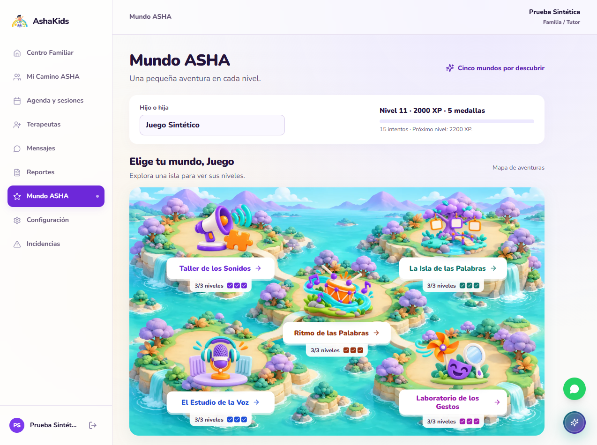

# ASHAKids — Auditoría de juegos y BD

Corte 2026-10-11-02 / V96. Fecha: 11 de octubre de 2026, America/Lima. Responsable: revisión técnica del proyecto.

Repositorio: https://github.com/sromansilva/ashakids-platform . Rama: feat/piero-dev. SHA inicial auditado: 6558a0776dd41302d3435819f3644fa9f1ff33f8 (V93), con el diff de juegos descrito aquí. Se incorporaron por fast-forward, sin conflictos, V94 del equipo (7b647aa3f0ca1c5a106edc537ac466411ec1c84c) y V95 de cabeceras (32df0e8b8459e8a5f78f1d7f311a029e4f58756e), base de cierre. El SHA final se identifica mediante V96_Corregir_Guardado_Juegos; este informe acompaña ese commit.

Entornos: Windows, Python 3.13, React 18.3.1, Vite 6.4.4, FastAPI/SQLAlchemy asyncpg, PostgreSQL 17.6. Escrituras exclusivamente en una BD local descartable y datos sintéticos; Supabase compartido exclusivamente READ ONLY por TLS. Alcance: cinco mundos básicos, quince niveles, persistencia, medallas, XP, reintentos y autorización. Fecha académica acordada: 09/10/2026, 18:00 Lima; este corte es posterior.

## 01. Dictamen ejecutivo

El fallo de la captura se reprodujo: al completar un mundo, el backend insertaba el intento con 100 XP y luego intentaba actualizarlo a 200 XP para añadir la medalla. El rol runtime carece de UPDATE sobre resultados_nivel. PostgreSQL devolvía 42501 y la API respondía 503 con el mensaje genérico de BD no disponible. La conexión compartida sí respondió correctamente.

La corrección calcula el premio completo antes del INSERT, preservando los permisos y la transacción. No requiere migración ni cambios en datos clínicos. En la prueba de navegador, los quince niveles guardan y el progreso persiste al recargar.

| Indicador | Resultado nuevo | Evidencia |
| --- | --- | --- |
| Reproducción previa | 1 fallo / 2 correctas; HTTP503 y SQL42501 | backend-before.txt |
| API y SQL restringido | 8 pruebas correctas, 0 omitidas | backend-after.txt |
| Frontend con API simulada | 16 pruebas correctas | frontend-tests.txt |
| Navegador y SQL real local | 15 intentos, 2000 XP, 5 medallas | browser-results.json y database-persistence.json |
| BD compartida | TLS, READ ONLY, 8 lecturas y 5 medallas de catálogo | database-readonly.json |

<!-- pagebreak -->

## 02. Arquitectura y cambios realizados

React utiliza learningGames mediante HTTP/JSON; FastAPI autoriza por familia/paciente y guarda mediante SQLAlchemy/PostgreSQL. El navegador no recibe credenciales de BD. Se conserva el bloqueo del paciente para serializar intentos, el UUID idempotente y la comprobación de respuestas en servidor.

backend/app/services/juegos.py reúne los niveles correctos anteriores más el resultado actual y calcula la medalla antes de insertar. ResultadoNivel contiene su premio definitivo desde el primer guardado. El perfil, actividad, objetivo y medalla se actualizan en la misma transacción. Los intentos ya persistidos conservan su carácter inmutable. No cambia una decisión arquitectónica y no se requiere ADR nuevo.

| Entidad física | Relación / operación comprobada |
| --- | --- |
| actividades, objetivos | Actividad del paciente por mundo/version; objetivo asociado, actualizable |
| mundos, niveles | Mundo asociado a actividad; nivel asociado a mundo; SELECT/INSERT |
| resultados_nivel | FK de paciente y nivel; INSERT con premio final; sin UPDATE |
| perfiles | Perfil del paciente: experiencia y nivel actualizados |
| logros, perfil_logros | Catálogo de cinco medallas; vínculo de perfil y logro insertado una vez |

La inspección compartida encontró 33 tablas con RLS y un rol sin superusuario, BYPASSRLS, creación de roles o BD. El comparador cargó 22 modelos y encontró una diferencia de tipo ajena a juegos: mensaje_adjuntos.tamano_bytes, integer en ORM frente a bigint en BD. No es una certificación de todos los modelos, defaults ni datos. Evidencia: schema-readonly.json.

Nuevos archivos: scripts/verify_games_readonly.py permite repetir la inspección sin devolver PII; tests/test_learning_games.py añade cinco regresiones de premio/medalla y ausencia de UPDATE. Cada caso reinicia únicamente el limitador de login de pruebas, conservando sus límites reales. Los permisos productivos permanecen iguales.

<!-- pagebreak -->

## 03. APIs funcionando: identidad y pacientes

| Operación | Estado observado / entorno |
| --- | --- |
| POST /api/v1/auth/login | 200 con cinco identidades sintéticas; fixture local |
| GET /api/v1/auth/me | 200 en navegador local autenticado por cookie |
| GET /api/v1/padres/hijos y /pacientes | 200; selección del paciente sintético en navegador |
| GET /api/v1/pacientes/{id}/juegos | 200 para tutor propietario; 404 para otro tutor |
| POST de intento por otro tutor o terapeuta | 404 y 403 respectivamente; pruebas API local |
| Intento en mundo no asignado | 403; el plan profesional limita el acceso |

Los usuarios y pacientes de prueba se crean exclusivamente en ashakids_test_games_v94, en loopback. No se crearon cuentas ni sesiones de autenticación en el entorno compartido. Las lecturas compartidas solo incluyen metadatos y agregados por mundo, sin nombres, identificadores de pacientes ni respuestas.

## 04. APIs funcionando: juegos y sistema

| Mundo | Navegador: niveles 1 / 2 / 3 | SQL posterior |
| --- | --- | --- |
| HABLA | 200 / 200 / 200 | 3 correctos, 400 XP |
| LENGUAJE | 200 / 200 / 200 | 3 correctos, 400 XP |
| FLUIDEZ | 200 / 200 / 200 | 3 correctos, 400 XP |
| VOZ | 200 / 200 / 200 | 3 correctos, 400 XP |
| OROFACIAL | 200 / 200 / 200 | 3 correctos, 400 XP |

POST /api/v1/pacientes/{id}/juegos/{mundo}/intentos guarda 100, 100 y 200 XP por mundo al resolver en orden, incluyendo el bono de la medalla. GET posterior y recarga muestran nivel11, 2000 XP, quince intentos y cinco medallas. La lectura SQL independiente confirma esas cifras con el rol sin UPDATE de intentos.

La suite API también prueba nivel3 primero, respuesta incorrecta sin XP, repetición sin premio duplicado, UUID idéntico sin fila nueva, UUID reutilizado con payload distinto (409), concurrencia sin XP duplicado y mundo no asignado. Estos rechazos esperados son comprobaciones de autorización/contrato.

<!-- pagebreak -->

## 05. Capacidades faltantes y límites

| Capacidad | Estado / siguiente acción |
| --- | --- |
| Guardado compartido después de V96 | No ensayado con datos reales. Desplegar/reiniciar API y aceptar con cohorte autorizada |
| Audio de pistas | Botón invocado en los 15 niveles; no se certifica sonido audible ni voces del dispositivo |
| Juegos terapéuticos definitivos | Continúan siendo actividades básicas de simulación; no acreditan evolución clínica |
| Carga, móviles y todos los módulos | Fuera de esta ejecución; no inferir cobertura por el build |
| Tipo de adjuntos ORM/BD | Diferencia documentada, sin relación con el error de juegos; requiere tarea aparte |
| Pagos | Fuera del alcance indicado por el profesor; sin implementación |

## 06. Seguridad y riesgos priorizados

| Prioridad | Hallazgo | Acción y evidencia |
| --- | --- | --- |
| Alta, corregido | UPDATE no autorizado impide completar cualquier mundo | Premio final en INSERT; 5 regresiones específicas y rol SQL restringido |
| Control conservado | Duplicación por reintento/concurrencia | UUID, bloqueo por paciente y pruebas de premio único |
| Control conservado | Acceso a progreso ajeno o mundo no asignado | 404/403 probados en API; autorización en FastAPI |
| Operativa | Proceso remoto puede ejecutar código anterior | Publicar V96 y verificar despliegue antes de declarar aceptación productiva |

No se otorgó UPDATE a resultados_nivel ni se ampliaron privilegios del runtime. Las políticas RLS existentes permiten al backend sus operaciones; el aislamiento familiar depende además de FastAPI. No se declara pentest ni cumplimiento normativo. El informe no contiene tokens, cookies ni contraseñas reales.

La primera ejecución ampliada obtuvo 5 correctas y 3 errores de preparación por el límite acumulado de login (429). Se aisló ese estado por caso. Una ejecución intermedia usó un nombre incorrecto de la variable de limpieza y falló el TRUNCATE local; se corrigió a ASHAKIDS_TEST_ADMIN_DATABASE_URL. La ejecución final de ocho casos no tiene fallos. No se modificó el limitador de producción.

<!-- pagebreak -->

## 07. Evidencia de validación y límites

Evidencia de este corte: docs/evidence/audit-2026-10-11-02/. Cada archivo corresponde a una ejecución nueva. No se reutilizan cifras de auditorías anteriores.

| Comando / caso | Resultado y evidencia |
| --- | --- |
| backend: python -m pytest tests/test_learning_games.py -q --tb=short | 8 PASS en 7,96 s tras incorporar V95; backend-after.txt y backend-api.json |
| frontend: vitest run tests/demo-worlds.test.tsx tests/family-center.test.tsx | 16 PASS / 2 archivos; API simulada, frontend-tests.txt |
| python -m scripts.verify_games_readonly --output [evidencia] | READ ONLY/TLS, 8 lecturas aprobadas; database-readonly.json |
| python -m scripts.inspect_schema_compatibility --target shared --output [evidencia] | Metadatos33 tablas; schema-readonly.json; aviso de ciclo FK del comparador |
| Chrome/Playwright, React5188 → API8002 → PostgreSQL6545 | 15 guardados200, recarga persistente y 0 errores JS; browser-results.json y seis capturas UI |
| Lectura SQL independiente después del navegador | 5 mundos x 3 correctos / 400 XP, perfil2000/nivel11, 5 medallas; database-persistence.json |
| vite build después de integrar V94 | PASS; build.txt. Aviso Node DEP0205 existente |
| Graphify refresh/check y git diff --check | Estado registrado en quality-checks.txt al cierre |

Para repetir la integración SQL, preparar PostgreSQL local descartable con scripts/db_creation.sql y los permisos B02 más migración008; runtime sin UPDATE de resultados_nivel y propietario solo para limpieza. Configurar ASHAKIDS_TEST_DATABASE_URL y ASHAKIDS_TEST_ADMIN_DATABASE_URL para la misma BD local ashakids_test_*. La guarda del fixture rechaza destinos remotos.

Recorrido web: tutor sintético con plan que asigne los cinco mundos; abrir cada mundo y jugar niveles1–3 usando las respuestas del catálogo servidor de prueba; comprobar feedback, medallas y recargar. La ejecución automatizada utilizó Chrome1274x950, cookie real local y API sin mocks, después de incorporar V94. La consulta SQL se hizo antes de retirar el fixture. Tras V95 de cabeceras se repitieron las ocho pruebas API/SQL, sin repetir el navegador. No modifica pacientes compartidos.

| Rúbrica recibida | Evidencia de este alcance / límite |
| --- | --- |
| Arquitectura/backend | Flujo React/HTTP/FastAPI/SQL ejecutado; no auditoría integral |
| Modelo físico y operaciones BD | Relaciones de ocho tablas, ACL y persistencia local; BD compartida solo lectura |
| Seguridad/usuarios/permisos | Tutor ajeno, terapeuta, mundo no asignado, rol restringido e idempotencia |
| Pruebas funcionales/no funcionales | Quince niveles, reintentos/concurrencia; sin prueba de carga ni aceptación clínica |

<!-- pagebreak -->

## 08. Cierre y ruta de entrega

Cierre coherente V96_Corregir_Guardado_Juegos: servicio, cinco regresiones, script de inspección, auditoría/PDF, evidencia y contexto/relevo. Integración/publicación normal en dev y feat/piero-dev al finalizar; verificar SHA de ambas referencias y CI. El estado efectivo se comunica después del push; este PDF no prueba despliegue remoto.

Siguiente aceptación: reiniciar/desplegar backend con V96 y, en una sesión familiar autorizada, reintentar HABLA nivel3. Debe guardar, añadir solo el bono pendiente y conservar los intentos anteriores. No necesita cambios de permisos ni nueva migración. El navegador local del usuario en8000 puede requerir reinicio del proceso; el servidor remoto requiere comprobar su versión efectiva.

La conexión compartida y su catálogo quedaron verificados sin escrituras. Las capturas siguientes usan únicamente datos sintéticos y muestran progreso persistente después de recargar.

