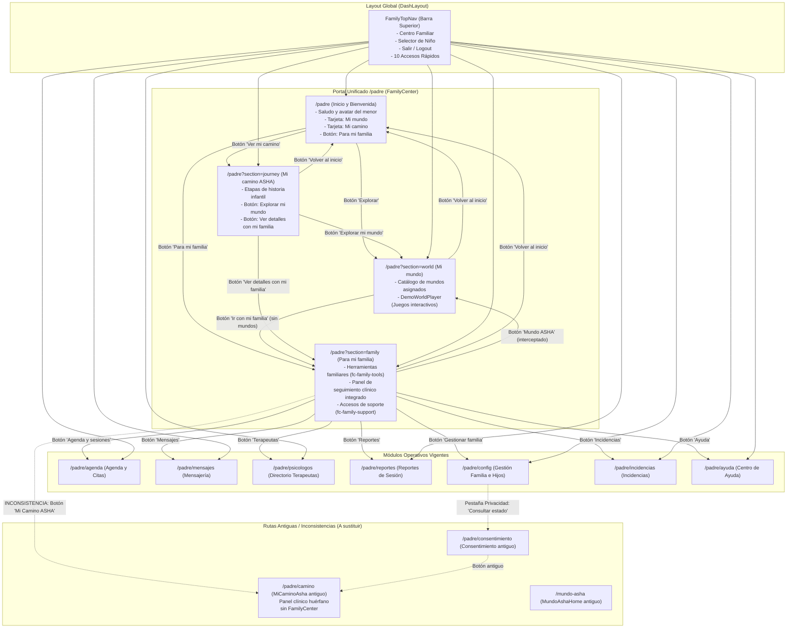

# ASHAKids — Auditoría Técnica de Navegación del Rol Padre (Fase 1)

**Código de corte:** `2026-10-21-01`  
**Fecha de auditoría:** 21 de octubre de 2026  
**Rama activa:** `feat/nlavadom`  
**Commit base auditado:** `b1b1f9e327b73924095f0510debaec9936a99d9c` (`V115_Diseno_Botones_Navbar_Centro_Familiar`)  
**Repositorio oficial:** https://github.com/sromansilva/ashakids-platform  
**Tipo de entrega:** Auditoría técnica estricta de navegación e inventario de rutas visibles (Solo lectura / Sin modificación de código de aplicación)

---

## A. Resumen Ejecutivo

La presente auditoría evalúa de forma exhaustiva el sistema de navegación del rol **PADRE** en ASHAKids, analizando los controles interactivos visibles, sus destinos reales en el código fuente del frontend (`frontend/src/`) y la coherencia del flujo de usuario tras la adopción del portal unificado `FamilyCenter` y el navbar superior continuo `FamilyTopNav`.

### Estado actual de la navegación
1. **Punto de entrada principal:** Tras iniciar sesión con el rol `PADRE`, el sistema redirige mediante `loginDestination()` a `/padre`. Dicha ruta monta el componente `PadreHome` (`FamilyCenter`), presentando una pantalla de bienvenida personalizada con saludo por el nombre del menor seleccionado y acceso a las tres áreas funcionales del rol:
   - **Mi mundo:** `/padre?section=world`
   - **Mi camino ASHA:** `/padre?section=journey`
   - **Para mi familia:** `/padre?section=family`
2. **Estructura de navegación global:** El rol padre opera sin el sidebar lateral clásico (`Sidebar.tsx` deshabilitado para rol `padre`). En su lugar, el diseño utiliza un navbar superior persistente (`FamilyTopNav.tsx`) integrado en `DashLayout.tsx`.
3. **Hallazgos críticos observados:**
   - **Inconsistencia de ruta antigua en botón visible:** En la sección "Para mi familia" (`/padre?section=family`), la cuadrícula de herramientas familiares (`fc-family-tools`) contiene el botón interactivo **"Mi Camino ASHA"**, cuyo destino efectivo es `/padre/camino`. Esta ruta monta el componente antiguo `MiCaminoAsha` (un visor aislado de `FamilyTrackingPanel`), en lugar del destino vigente y conceptualmente correcto `/padre?section=journey`.
   - **Duplicidad de controles en `/padre`:** Al estar presentes simultáneamente `FamilyTopNav` (desde el layout) y `.fc-top` (dentro del componente de página `FamilyCenter`), el usuario visualiza en pantalla dos botones "Centro Familiar" y dos selectores de niño desplegables superpuestos verticalmente.
   - **Desconexión de estado activo en navbar superior:** `DashLayout.tsx` no suministra las propiedades `activeSection` ni `onSelectSection` al invocar `FamilyTopNav`, lo que ocasiona que los botones de sección ("Mi Mundo", "Mi Camino", "Para mi familia") nunca adquieran la clase visual activa (`.ftn-nav-btn--active`).
   - **Redundancia múltiple de accesos:** Dentro de "Para mi familia", existen enlaces duplicados a reportes e incidencias distribuidos entre `FamilyTopNav`, `fc-family-tools`, el panel embebido y `fc-family-support`.

---

## B. Inventario de Navbars y Puntos de Entrada

| Identificador | Componente responsable | Archivo fuente | Ubicación en pantalla | Descripción y alcance |
|---|---|---|---|---|
| **NAV-01: Navbar Superior Constante** | `FamilyTopNav` | [FamilyTopNav.tsx](file:///c:/Users/HailQueso/Desktop/ashakid/frontend/src/pages/padre/dashboard/FamilyTopNav.tsx) | Franja superior fija de la aplicación (línea 100 de `DashLayout.tsx`). | Presente en todas las pantallas del padre. Contiene logo/marca "Centro Familiar", selector de niño activo, nombre del tutor, botón "Salir" y una barra horizontal de 10 botones de acceso rápido. |
| **NAV-02: Encabezado Interno del Centro Familiar** | `FamilyCenter` (`.fc-top`) | [FamilyCenter.tsx](file:///c:/Users/HailQueso/Desktop/ashakid/frontend/src/pages/padre/dashboard/FamilyCenter.tsx#L55-L71) | Encabezado dentro del contenedor de contenido principal en `/padre`. | Presente en `/padre` (con y sin parámetro `section`). Incluye botón textual "Centro Familiar", selector desplegable de niño (`.fc-profile`) y botón destacado "Para mi familia". |
| **NAV-03: Botón de Retorno Contextual** | `FamilyCenter` (`.fc-back`) | [FamilyCenter.tsx](file:///c:/Users/HailQueso/Desktop/ashakid/frontend/src/pages/padre/dashboard/FamilyCenter.tsx#L72) | Bajo el encabezado interno en `/padre?section=...`. | Visible solo cuando `section` está activa (`world`, `journey`, `family`). Permite retornar a la pantalla de bienvenida (`/padre`). |
| **NAV-04: Cuadrícula de Herramientas Familiares** | `FamilyAdultArea` (`.fc-family-tools`) | [FamilyCenterSections.tsx](file:///c:/Users/HailQueso/Desktop/ashakid/frontend/src/pages/padre/dashboard/FamilyCenterSections.tsx#L25-L37) | Área superior de la sección "Para mi familia" (`/padre?section=family`). | Grilla de 8 tarjetas interactivas tipo botón hacia áreas operativas y clínicas del padre (Agenda, Mensajes, Terapeutas, Reportes, Configuración, Mundo ASHA, Mi Camino ASHA, Incidencias). |
| **NAV-05: Barra de Soporte Complementario** | `FamilyAdultArea` (`.fc-family-support`) | [FamilyCenterSections.tsx](file:///c:/Users/HailQueso/Desktop/ashakid/frontend/src/pages/padre/dashboard/FamilyCenterSections.tsx#L39) | Pie de página de la sección "Para mi familia". | Barra de enlaces secundarios hacia "Todos los reportes", "Ayuda" e "Incidencias". |
| **P-BIEN: Tarjetas de Bienvenida** | `FamilyCenter` (`.fc-destinations`) | [FamilyCenter.tsx](file:///c:/Users/HailQueso/Desktop/ashakid/frontend/src/pages/padre/dashboard/FamilyCenter.tsx#L81-L90) | Cuerpo de la pantalla de bienvenida `/padre` (cuando no hay parámetro `section`). | Dos tarjetas ilustradas de gran tamaño: "Mi mundo" (botón "Explorar") y "Mi camino" (botón "Ver mi camino"). |

---

## C. Mapa de Navegación Vigente

El siguiente diagrama detalla la arquitectura de navegación verificada en el código, separando con rigor las rutas **vigentes** (núcleo y secciones del portal) de las rutas **antiguas e inconsistentes**:



---

## D. Tabla de Botones y Destinos

A continuación se registra cada botón de navegación visible en la interfaz del rol Padre, diferenciando los cambios de ruta y parámetros respecto a acciones locales de interfaz:

| Pantalla de origen | Texto del botón / Control | Tipo de control | Destino efectivo | Clasificación | Observaciones |
|---|---|---|---|---|---|
| **Global (TopNav)** | "Centro Familiar" | Botón de marca | `/padre` | **Vigente** | Ejecuta `navigate('/padre')` o `onSelectSection(null)`. Retorna a la bienvenida. |
| **Global (TopNav)** | Selector de Niño (Avatar + Nombre) | `<details>` dropdown | N/A (Estado React) | **Vigente** | Modifica el paciente activo en `useSelectedFamilyPatient`. No altera la URL. |
| **Global (TopNav)** | "Salir" | Botón con icono `LogOut` | `/login` | **Vigente** | Cierra la sesión (`logout()`) y redirige al inicio de sesión. |
| **Global (TopNav)** | "Mi Mundo" | Botón de navegación rápida | `/padre?section=world` | **Vigente** | Navega a la vista de mundos y juegos asignados. |
| **Global (TopNav)** | "Mi Camino" | Botón de navegación rápida | `/padre?section=journey` | **Vigente** | Navega a la vista de etapas del camino infantil. |
| **Global (TopNav)** | "Para mi familia" | Botón de navegación rápida | `/padre?section=family` | **Vigente** | Navega al área de herramientas familiares. |
| **Global (TopNav)** | "Agenda y sesiones" | Botón de navegación rápida | `/padre/agenda` | **Vigente** | Navega a la gestión de citas y sesiones familiares. |
| **Global (TopNav)** | "Mensajes" | Botón de navegación rápida | `/padre/mensajes` | **Vigente** | Abre el centro de mensajería con profesionales. |
| **Global (TopNav)** | "Terapeutas" | Botón de navegación rápida | `/padre/psicologos` | **Vigente** | Navega al catálogo de terapeutas para solicitar citas. |
| **Global (TopNav)** | "Reportes" | Botón de navegación rápida | `/padre/reportes` | **Vigente** | Navega a la consulta y descarga de reportes. |
| **Global (TopNav)** | "Gestionar familia" | Botón de navegación rápida | `/padre/config` | **Vigente** | Navega a la configuración de cuenta y perfiles de hijos. |
| **Global (TopNav)** | "Incidencias" | Botón de navegación rápida | `/padre/incidencias` | **Vigente** | Navega al formulario y lista de incidencias. |
| **Global (TopNav)** | "Ayuda" | Botón de navegación rápida | `/padre/ayuda` | **Vigente** | Navega al portal de ayuda y soporte. |
| **`/padre` (Interno)** | "Centro Familiar" (`.fc-home-link`) | Botón de texto | `/padre` | **Vigente (Duplicado)** | Duplica la acción del botón de marca en `FamilyTopNav`. |
| **`/padre` (Interno)** | Selector de Niño (`.fc-profile`) | `<details>` dropdown | N/A (Estado React) | **Vigente (Duplicado)** | Duplica exactamente el selector de niño de `FamilyTopNav`. |
| **`/padre` (Interno)** | "Para mi familia" (`.fc-family-button`) | Botón con icono `Users` | `/padre?section=family` | **Vigente (Duplicado)** | Duplica el acceso de "Para mi familia" del TopNav. |
| **`/padre` (Sin sección)** | "Explorar" (Tarjeta Mi mundo) | Botón CTA (`.fc-button`) | `/padre?section=world` | **Vigente** | Abre la sección de exploración lúdica. |
| **`/padre` (Sin sección)** | "Ver mi camino" (Tarjeta Mi camino) | Botón outline | `/padre?section=journey` | **Vigente** | Abre la sección del recorrido infantil. |
| **`/padre` (Sin sección, sin hijos)** | "Gestionar hijos" | Botón CTA (`.fc-button`) | `/padre/config` | **Vigente** | Estado vacío: invita a registrar el primer hijo. |
| **`/padre?section=...`** | "Volver al inicio" (`.fc-back`) | Botón con flecha izquierda | `/padre` | **Vigente** | Limpia `section` y retorna a la pantalla de bienvenida. |
| **`/padre?section=world`** | "Explorar" (por mundo asignado) | Botón en tarjeta | `/padre?section=world&world=[ID]` | **Vigente** | Carga el reproductor de juego del mundo seleccionado. |
| **`/padre?section=world&world=...`** | "Volver" (en `DemoWorldPlayer`) | Botón en cabecera de juego | `/padre?section=world` | **Vigente** | Cierra el juego y regresa a la lista de mundos asignados. |
| **`/padre?section=world` (sin mundos)** | "Ir con mi familia" | Botón outline | `/padre?section=family` | **Vigente** | Estado vacío cuando el menor no tiene mundos asignados. |
| **`/padre?section=journey`** | "Explorar mi mundo" | Botón CTA (`.fc-button`) | `/padre?section=world` | **Vigente** | Navegación cruzada sugerida para el niño. |
| **`/padre?section=journey`** | "Ver detalles con mi familia" | Botón textual | `/padre?section=family` | **Vigente** | Navegación hacia el panel de seguimiento de los tutores. |
| **`/padre?section=family` (Grid)** | "Agenda y sesiones" | Botón en cuadrícula | `/padre/agenda` | **Vigente** | Acceso a citas desde las herramientas de familia. |
| **`/padre?section=family` (Grid)** | "Mensajes" | Botón en cuadrícula | `/padre/mensajes` | **Vigente** | Acceso a mensajes desde las herramientas de familia. |
| **`/padre?section=family` (Grid)** | "Terapeutas" | Botón en cuadrícula | `/padre/psicologos` | **Vigente** | Acceso a terapeutas desde herramientas de familia. |
| **`/padre?section=family` (Grid)** | "Reportes" | Botón en cuadrícula | `/padre/reportes` | **Vigente** | Acceso a reportes desde herramientas de familia. |
| **`/padre?section=family` (Grid)** | "Gestionar familia" | Botón en cuadrícula | `/padre/config` | **Vigente** | Acceso a configuración desde herramientas de familia. |
| **`/padre?section=family` (Grid)** | "Mundo ASHA" | Botón en cuadrícula | `/padre?section=world` | **Vigente** | `FamilyCenter` intercepta `mundo-asha` y abre `section=world`. |
| **`/padre?section=family` (Grid)** | **"Mi Camino ASHA"** | **Botón en cuadrícula** | **`/padre/camino`** | **Antigua / Inconsistente** | **¡Error confirmado! Conduce a la ruta antigua `/padre/camino` en vez de `/padre?section=journey`.** |
| **`/padre?section=family` (Grid)** | "Incidencias" | Botón en cuadrícula | `/padre/incidencias` | **Vigente** | Acceso a incidencias desde herramientas de familia. |
| **`/padre?section=family` (Tracking)** | "Actualizar seguimiento" | Botón con icono de recarga | N/A (Acción de datos) | **Vigente** | Ejecuta `data.retry()` para refrescar tratamientos y citas. |
| **`/padre?section=family` (Tracking)** | Pestañas ("Resumen", "Sesiones", ...) | Botones de pestaña | N/A (Estado React) | **Vigente** | Alterna vistas internas del panel clínico. |
| **`/padre?section=family` (Tracking)** | "Consultar o reprogramar en agenda" | Botón CTA | `/padre/agenda` | **Vigente** | Enlace contextual desde la tarjeta de próxima cita. |
| **`/padre?section=family` (Tracking)** | "Ver reportes de la familia" | Botón outline | `/padre/reportes` | **Vigente** | Enlace contextual desde el resumen de reportes. |
| **`/padre?section=family` (Tracking)** | "Explorar demostración" | Botón secundario | `/padre?section=world` | **Vigente** | Interceptado hacia `section=world`. |
| **`/padre?section=family` (Soporte)** | "Todos los reportes" | Botón de lista | `/padre/reportes` | **Vigente (Duplicado)** | Tercer acceso repetido hacia `/padre/reportes`. |
| **`/padre?section=family` (Soporte)** | "Ayuda" | Botón de lista | `/padre/ayuda` | **Vigente** | Acceso al módulo de ayuda. |
| **`/padre?section=family` (Soporte)** | "Incidencias" | Botón de lista | `/padre/incidencias` | **Vigente (Duplicado)** | Segundo acceso repetido hacia `/padre/incidencias`. |
| **`/padre/psicologos`** | "Consultar mi agenda" | Botón outline | `/padre/agenda` | **Vigente** | Retorno rápido hacia la agenda tras ver profesionales. |
| **`/padre/ayuda`** | "Ver agenda" / "Abrir mensajes" | Botones de acceso rápido | `/padre/agenda`, `/padre/mensajes` | **Vigente** | Accesos rápidos provistos en el panel lateral de ayuda. |
| **`/padre/config` (Privacidad)** | "Consultar estado de consentimientos" | Botón en pestaña | `/padre/consentimiento` | **Antigua** | Enlace residual a la pantalla antigua de consentimientos. |
| **`/padre/consentimiento`** | "Consultar Mi Camino ASHA" | Botón outline | `/padre/camino` | **Antigua / Inconsistente** | Enlace residual que perpetúa el acceso a `/padre/camino`. |

---

## E. Inconsistencias y Duplicidades

### 1. Inconsistencia Crítica: Botón "Mi Camino ASHA" hacia ruta obsoleta `/padre/camino`
- **Qué ve el usuario:** En `/padre?section=family`, dentro del contenedor `.fc-family-tools`, el usuario ve una tarjeta interactiva con ícono de brújula (`Compass`) rotulada "Mi Camino ASHA".
- **Qué ruta se activa realmente:** Al pulsar el botón, se ejecuta `go('padre/camino')`, redirigiendo la URL a `/padre/camino`.
- **Qué componente responde:** En [AppRouter.tsx#L41](file:///c:/Users/HailQueso/Desktop/ashakid/frontend/src/app/AppRouter.tsx#L41), `/padre/camino` monta `MiCaminoAsha`, el cual únicamente renderiza `<FamilyTrackingPanel mode="journey" />` de forma autónoma.
- **Cuál debería ser el comportamiento conceptual:** El destino correcto y vigente es `/padre?section=journey` (`FamilyChildJourney`), que muestra las etapas lúdicas del niño. El panel clínico para adultos ya se encuentra embebido dentro de `/padre?section=family`, por lo que saltar a `/padre/camino` no solo rompe el nuevo modelo de navegación sino que descontextualiza al usuario fuera del Centro Familiar.
- **Evidencia en código:**
  - En [FamilyCenterSections.tsx#L32](file:///c:/Users/HailQueso/Desktop/ashakid/frontend/src/pages/padre/dashboard/FamilyCenterSections.tsx#L32):  
    `{ label: 'Mi Camino ASHA', view: 'padre/camino', icon: Compass }`
  - En [FamilyCenter.tsx#L51](file:///c:/Users/HailQueso/Desktop/ashakid/frontend/src/pages/padre/dashboard/FamilyCenter.tsx#L51):  
    `const navigate = (view: View) => view === 'mundo-asha' ? open('world') : go(view);`  
    *(Se intercepta `mundo-asha` pero se omitió interceptar `padre/camino` para redirigirlo a `open('journey')`)*.

### 2. Duplicidad de Navbars y Selectores en Pantalla (`FamilyTopNav` vs `.fc-top`)
- **Qué ve el usuario:** Al encontrarse en cualquier pantalla de `/padre`, se muestran dos barras de encabezado apiladas:
  1. La barra superior global `FamilyTopNav` con "Centro Familiar" y selector de hijo.
  2. Inmediatamente abajo, el encabezado interno `.fc-top` de `FamilyCenter` con otro botón "Centro Familiar", otro selector desplegable de hijo y otro botón "Para mi familia".
- **Cuál debería ser el comportamiento conceptual:** Un único Navbar superior unificado. El encabezado interno `.fc-top` debe removerse o integrarse completamente en el navbar superior, evitando redundancias visuales y el desconcierto de tener dos menús desplegables del mismo menor a pocos píxeles de distancia.
- **Evidencia en código:** [DashLayout.tsx#L100](file:///c:/Users/HailQueso/Desktop/ashakid/frontend/src/app/layouts/DashLayout.tsx#L100) vs [FamilyCenter.tsx#L55-L71](file:///c:/Users/HailQueso/Desktop/ashakid/frontend/src/pages/padre/dashboard/FamilyCenter.tsx#L55-L71).

### 3. Falta de Sincronización del Estado Activo en `FamilyTopNav`
- **Qué ve el usuario:** Al navegar por `/padre?section=world`, `/padre?section=journey` o `/padre?section=family`, los botones "Mi Mundo", "Mi Camino" y "Para mi familia" de la barra superior nunca aparecen resaltados como seleccionados.
- **Qué ocurre en el código:** `FamilyTopNav.tsx` implementa la lógica para iluminar la sección:
  ```tsx
  if (item.section) {
    return cur === 'padre' && activeSection === item.section;
  }
  ```
  Sin embargo, en `DashLayout.tsx`:
  ```tsx
  {isFamily && <FamilyTopNav cur={cur} go={go} logout={logout} padreUserName={padreUserName} />}
  ```
  La propiedad `activeSection` nunca se le pasa a `FamilyTopNav`. Al ser `undefined`, la condición nunca se cumple.
- **Comportamiento conceptual:** El navbar superior debe leer automáticamente el parámetro `section` de la URL o recibirlo desde el contexto/layout para reflejar fielmente en qué sección se encuentra el usuario.

### 4. Saturación y Redundancia en "Para mi familia"
- **Qué ve el usuario:** Dentro de `/padre?section=family`, los accesos a "Reportes" e "Incidencias" aparecen triplicados:
  - En `FamilyTopNav` (barra superior persistente).
  - En `fc-family-tools` (cuadrícula de herramientas).
  - En `fc-family-support` (barra inferior de soporte).
  - Adicionalmente, dentro del componente `FamilyTrackingPanel` aparece el botón "Ver reportes de la familia".
- **Comportamiento conceptual:** Debe existir una jerarquía limpia donde la barra superior o una cuadrícula depurada concentren las acciones principales, eliminando redundancias innecesarias en el pie de página.

---

## F. Propuesta de Navegación Objetivo

Sin aplicar modificaciones de código en esta fase, se define formalmente la arquitectura para la Fase 2:

### 1. Cuatro Endpoints Principales Canónicos
- **/padre:** Inicio y Bienvenida.
  - Saludo amigable al menor seleccionado con su avatar oficial.
  - Tarjetas directas hacia **Mi mundo** (`/padre?section=world`) y **Mi camino ASHA** (`/padre?section=journey`).
  - Acceso prioritario al entorno de acompañamiento adulto mediante **Para mi familia** (`/padre?section=family`).
  - Ausencia de sub-navbars contextuales complejos en el inicio: el padre entra a un espacio despejado y acogedor.
- **/padre?section=world:** Mi mundo.
  - Experiencia lúdica del niño con actividades asignadas por el profesional y reproductor guiado (`DemoWorldPlayer`).
- **/padre?section=journey:** Mi camino ASHA.
  - El recorrido visual e hitos del menor ("Nos conocemos", "Preparamos tu aventura", "Seguimos juntos").
- **/padre?section=family:** Para mi familia.
  - Centro de control familiar con herramientas operativas (citas, mensajes, reportes) y panel de seguimiento clínico.

### 2. Navbar Global Uniforme
- **Consolidación en `FamilyTopNav`:** Mantener una única barra superior que agrupe la identidad de ASHAKids / Centro Familiar, el selector oficial de perfil del niño, la información del tutor y el botón Salir.
- **Eliminación de `.fc-top`:** Suprimir el encabezado secundario interno de `FamilyCenter` que genera duplicidad visual de selector y botones.
- **Sincronización reactiva:** Hacer que `FamilyTopNav` detecte la sección activa (`world`, `journey`, `family`) directamente desde `useSearchParams` para activar visualmente el botón correspondiente.

---

## G. Pendientes para la Fase 2

Para ejecutar la Fase 2 de unificación sin regresiones, se requerirá intervenir los siguientes puntos:

1. **Corrección de ruta en `FamilyCenterSections.tsx`:**
   - En la lista `tools`, modificar el botón "Mi Camino ASHA" para que su destino sea `/padre?section=journey` (o interceptar `padre/camino` en la función `navigate` de `FamilyCenter.tsx` para mapearlo a `open('journey')`).
2. **Eliminación de la cabecera redundante `.fc-top` en `FamilyCenter.tsx`:**
   - Retirar los elementos duplicados (botón textual "Centro Familiar", `<details className="fc-profile">` interno y botón "Para mi familia" redundante), dejando que `FamilyTopNav` asuma plenamente esta función.
3. **Paso de props o detección de sección en `FamilyTopNav.tsx` / `DashLayout.tsx`:**
   - Permitir que `FamilyTopNav` conozca la sección activa mediante `useSearchParams` (o props desde `DashLayout`), de modo que `isItemActive()` funcione para `section='world'`, `section='journey'` y `section='family'`.
4. **Deprecación / Redirección de `/padre/camino` en `AppRouter.tsx`:**
   - Configurar una redirección controlada desde `/padre/camino` hacia `/padre?section=journey` para que URLs marcadas o escritas manualmente no muestren la vista huérfana antigua.
5. **Limpieza de accesos en `fc-family-support`:**
   - Depurar los botones redundantes de "Todos los reportes" e "Incidencias" en el pie de página de `FamilyAdultArea`.
6. **Desconexión del enlace residual en `PadreConfig.tsx`:**
   - Revisar el botón hacia `/padre/consentimiento` en la pestaña Privacidad, integrando la consulta de estado dentro del flujo familiar regular.
7. **Verificación de regresión en tests:**
   - Asegurar que la suite unitaria (`npm test -- tests/family-center.test.tsx`) continúe en estado aprobatorio (9/9 tests PASS).

---

## H. Dictamen Técnico y Cierre de Auditoría

- **Dictamen:** **Auditoría de Navegación del Rol Padre Fase 1 COMPLETADA CON ÉXITO.**
- **Estado de código:** **100% Intacto.** No se ha modificado ningún archivo de código, componente, estilo, ruta ni base de datos.
- **Pruebas ejecutadas:** Verificación estática exhaustiva de referencias en código y comprobación de suite frontend (`vitest run tests/family-center.test.tsx` -> 9/9 superadas).
- **Control Git:** Rama `feat/nlavadom` preservada en commit `b1b1f9e`. No se ha realizado commit en GitHub ni push remoto alguno.
