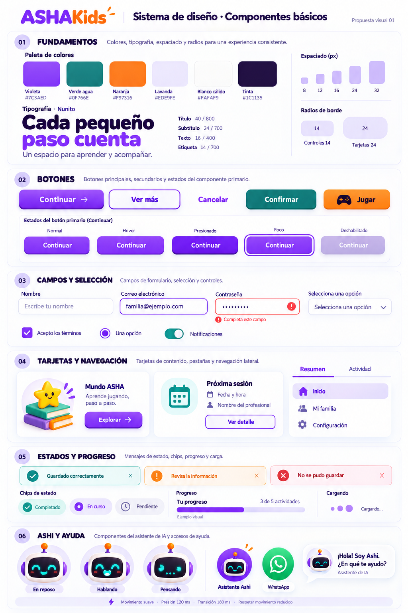

# ASHAKids · Sistema de componentes web

Versión de diseño: **1.1** · Fecha: **2026-10-11, America/Lima**

Estado: **especificación de implementación basada en la maqueta aprobada**. El CSS de
este documento es una base copiable, todavía no adoptada globalmente en la aplicación.
La landing ya utiliza `asha-glass` y sus tokens en superficies seleccionadas.
No confundir esta versión de diseño con la versión de API ni con los commits VNN.

Repositorio: https://github.com/sromansilva/ashakids-platform
Base documental: rama `feat/piero-dev`, V74, SHA `6fa5c5ebb8a7d517f0c8a70fed7b89d9406e28a3`.
La maqueta visual aprobada se conserva como referencia original del kit.

## 1. Los dos entregables y su autoridad

1. [ASHAKIDS_UI_KIT.png](ASHAKIDS_UI_KIT.png): maqueta visual aprobada, generada con ImageGen.
2. Este documento: contrato de diseño, tokens, CSS, ejemplos HTML y guía de integración.



Mantener ambos archivos juntos al entregarlos a una IA. **La imagen manda sobre la
apariencia; este texto manda sobre medidas, estados, semántica y comportamiento.**
No reinterpretar el encargo como una nueva dirección artística. La imagen es una
referencia raster: no contiene fuentes, ilustraciones transparentes ni componentes
extraíbles. Las medidas siguientes formalizan el diseño; no son mediciones automáticas
de cada píxel de la imagen. El resultado deberá compararse visualmente con ella.

Esta especificación sustituye el lenguaje visual anterior para las superficies que se
migren expresamente. El `DESIGN.md` raíz sigue describiendo la implementación V38 actual;
actualizarlo junto con sus tokens cuando se implemente y verifique la migración, no antes.

### Instrucción lista para otra IA

> Implementa los componentes de ASHAKids usando este documento y la imagen adjunta como
> referencia conjunta. Conserva Nunito, la paleta exacta, el relieve inferior de botones,
> las tarjetas de cristal suave y la identidad del robot Ashi. Utiliza los tokens y las
> clases `asha-*`; adapta los componentes compartidos existentes sin duplicar su lógica.
> Conserva rutas, permisos, contratos, validaciones y datos. No conviertas ejemplos de
> esta guía en registros reales. Implementa primero una galería aislada de componentes
> con todos sus estados; compara capturas con la maqueta antes de migrar pantallas.
> No sustituyas la mascota por un emoji, oso, icono genérico ni robot diferente. Si falta
> el recurso de Ashi, declara ese pendiente y prepara el espacio sin dar por terminada
> la fidelidad visual. Sigue el plan, los contratos y los criterios de aceptación de este
> archivo; no declares IA, WhatsApp ni animación de voz funcional por dibujar su interfaz.

## 2. Dirección visual invariable

**Cálida, infantil y legible, con ejecución profesional.** Inspiración de Duolingo en
controles táctiles, formas redondeadas e ilustraciones expresivas. Identidad ASHAKids en
violeta, verde agua, naranja, blanco cálido y Ashi robot. No importar el verde de Duolingo.

- Blanco cálido como fondo dominante. Lavanda en superficies secundarias y selección.
- Violeta en acciones principales. Verde agua en confirmación y acompañamiento.
- Naranja en juegos e ilustraciones; texto oscuro en botones naranjas.
- Glassmorphism en navegación flotante, tarjetas sobre ilustraciones y paneles auxiliares
  breves. Formularios, tablas, mensajes y reportes mantienen fondos sólidos para lectura,
  contraste y exploración de datos.
- En administración y terapeuta: superficie tranquila, iconos lineales y poco relieve.
  En landing y Mundo ASHA: ilustraciones, botones táctiles y acentos más expresivos.
- No introducir gradientes de texto, halos intensos, confeti permanente ni nuevas
  mascotas. El brillo sutil de la maqueta se reproduce en materiales, no en cada texto.
- Logo: conservar el recurso oficial existente. El rótulo generado en la imagen no es
  un reemplazo autorizado de ese archivo.

## 3. Fundamentos y medidas

| Rol | Valor | Uso |
| --- | --- | --- |
| Primario | `#7C3AED` | Botones, enlaces, selección |
| Primario oscuro | `#5B21B6` | Base del relieve, foco, texto sobre lavanda |
| Verde agua | `#0F766E` | Éxito, confirmación, interruptor activo |
| Naranja | `#F97316` | Jugar, ilustraciones, acentos |
| Lavanda | `#EDE9FE` | Fondos suaves, selección |
| Fondo | `#FAFAF9` | Página |
| Superficie | `#FFFFFF` | Lectura, controles, mensajes |
| Tinta | `#1C1135` | Títulos y cuerpo |
| Texto secundario | `#615274` | Ayuda, placeholder y descripciones |
| Error | `#B42318` | Error y acción destructiva |
| Advertencia | `#9A3412` sobre `#FFF1E6` | Aviso textual legible |

Los colores semánticos amplían la paleta para errores; no constituyen otra identidad.
WhatsApp conserva su verde de marca solamente en su acceso propio.

### Glassmorphism: alcance y reglas de composición

El vidrio es una superficie de elevación, no un fondo universal. Aplicarlo sólo donde el
fondo aporte profundidad sin competir con la tarea: navegación flotante, tarjetas sobre
ilustración y paneles auxiliares breves. Mantener una única capa visual y suficiente
espacio entre el contenido y el borde.

La base es 84% blanco, borde violeta al 12% y desenfoque de 14px. Se diseñó para fondos
claros de la paleta ASHAKids. El desenfoque no garantiza contraste: comprobar el resultado
sobre los fondos más claros y oscuros donde aparecerá la superficie. Texto normal requiere
4.5:1 y texto grande o indicadores esenciales 3:1. Si no alcanza, subir la opacidad hasta
blanco sólido; no aclarar el texto ni añadir sombra para compensarlo.

No usar glass en campos, validaciones, controles, tablas, reportes, mensajes clínicos,
estados de error/éxito ni texto prolongado. Esos elementos necesitan color sólido y límites
visibles. No apilar paneles translúcidos. Estado, foco, selección y error se comunican con
etiqueta, forma o icono además del color.

En viewports menores de 768px se usa blanco opaco y se retira el desenfoque para cuidar
la lectura y el rendimiento. `@supports` entrega fondo sólido cuando `backdrop-filter` no
está disponible. El foco de teclado permanece visible y reduced-motion elimina transiciones
sin ocultar estados.

| Token | Valor | Aplicación |
| --- | --- | --- |
| `--asha-glass` | `rgb(255 255 255 / 84%)` | Superficie de escritorio en fondos claros |
| `--asha-glass-border` | `rgb(124 58 237 / 12%)` | Borde decorativo, no borde de campo |
| `--asha-glass-blur` | `14px` | Desenfoque del fondo |
| Fallback | `#FFFFFF` | Sin soporte o en móvil |

Estos valores son el punto de partida. La transparencia final se valida sobre la imagen y
el contenido reales; no equivale a certificación automática de contraste.

| Propiedad | Contrato |
| --- | --- |
| Familia | Nunito, pesos 400, 600, 700, 800 y 900; fallback system-ui |
| Título de pantalla | 40px/1.15, 800; móvil 32px |
| Hero landing | 48–64px/1.08, 900; móvil 36px |
| Subtítulo | 24px/1.25, 700 |
| Título de tarjeta | 20px/1.3, 800 |
| Cuerpo | 16px/1.6, 400 |
| Etiqueta | 14px/1.4, 700 |
| Texto auxiliar | 14px/1.5, 400; 12px sólo para metadatos no esenciales |
| Espaciado | 4, 8, 12, 16, 24, 32, 48, 64, 96px |
| Radio control / tarjeta | 14px / 24px |
| Radio badge / flotante | 999px / 50% |
| Botón sm / md / lg | Mínimo 44 / 48 / 56px; texto puede aumentar la altura |
| Campo / textarea | Mínimo 48px / 120px |
| Iconos funcionales | Lucide, 20px, trazo 2; 24px en navegación |
| Ancho contenido | Máximo 1200px; margen 24px, 16px en móvil |
| Separación tarjetas | 24px; 16px en móvil |
| Padding tarjeta | 24px; 20px en móvil |

No cargar otra fuente de encabezados para imitar los glifos generados. Nunito es el
contrato reproducible. Usar la carga de fuente existente y esperar `document.fonts.ready`
antes de comparar capturas. Preferir recursos locales autorizados al preparar producción.

## 4. CSS de referencia completo

Copiar **este único bloque CSS** a un archivo como `frontend/src/theme/asha-kit.css`.
Importarlo después de los estilos heredados. Poner `class="asha-ui"` en la raíz de la
superficie migrada y en la raíz de cualquier portal que se monte fuera de ella.
No activar todo el sistema globalmente antes de revisar los módulos.

Las clases tienen especificidad deliberada. Retirar clases Tailwind incompatibles de
los componentes migrados; no apilar este CSS sobre `rounded-*`, `bg-*`, `shadow-*`,
`text-*` o estilos inline que contradigan sus tokens. `data-density="calm"` reduce el
relieve en paneles profesionales. Todos los colores funcionales se declaran aquí.

```css
.asha-ui {
  --asha-primary: #7C3AED;
  --asha-primary-top: #8240ED;
  --asha-primary-hover: #6D28D9;
  --asha-primary-dark: #5B21B6;
  --asha-teal: #0F766E;
  --asha-teal-dark: #115E59;
  --asha-teal-soft: #E6F5F2;
  --asha-orange: #F97316;
  --asha-orange-hover: #EA580C;
  --asha-orange-dark: #9A3412;
  --asha-orange-ink: #351604;
  --asha-orange-soft: #FFF1E6;
  --asha-lavender: #EDE9FE;
  --asha-lavender-soft: #F5F3FF;
  --asha-bg: #FAFAF9;
  --asha-white: #FFFFFF;
  --asha-ink: #1C1135;
  --asha-muted: #615274;
  --asha-border: #DDD6EF;
  --asha-control-border: #86749E;
  --asha-error: #B42318;
  --asha-error-soft: #FFF1F2;
  --asha-disabled-bg: #E7DFF6;
  --asha-disabled-text: #675779;
  --asha-whatsapp: #25D366;
  --asha-glass: rgb(255 255 255 / 84%);
  --asha-glass-border: rgb(124 58 237 / 12%);
  --asha-glass-blur: 14px;
  --asha-font: "Nunito", system-ui, sans-serif;
  --asha-space-1: 4px;
  --asha-space-2: 8px;
  --asha-space-3: 12px;
  --asha-space-4: 16px;
  --asha-space-6: 24px;
  --asha-space-8: 32px;
  --asha-space-12: 48px;
  --asha-space-16: 64px;
  --asha-space-24: 96px;
  --asha-radius-control: 14px;
  --asha-radius-card: 24px;
  --asha-shadow: 0 8px 24px rgb(28 17 53 / 6%);
  --asha-shadow-raised: 0 12px 28px rgb(28 17 53 / 10%);
  --asha-duration-press: 120ms;
  --asha-duration-ui: 180ms;
  --asha-ease: cubic-bezier(.22, 1, .36, 1);
  --asha-fixed-bottom: 0px; /* Altura real de navegación inferior, si existe. */
  --asha-z-sticky: 20;
  --asha-z-help: 40;
  --asha-z-chat: 50;
  --asha-z-modal: 80;
  color: var(--asha-ink);
  background: var(--asha-bg);
  font: 400 16px/1.6 var(--asha-font);
  color-scheme: light;
  accent-color: var(--asha-primary);
  caret-color: var(--asha-primary-dark);
  scrollbar-color: var(--asha-control-border) var(--asha-lavender-soft);
  text-underline-offset: .2em;
}
.asha-ui, .asha-ui *, .asha-ui *::before, .asha-ui *::after { box-sizing: border-box; }
.asha-ui :where(button, input, textarea, select) { font: inherit; }
.asha-ui :where(h1, h2, h3, p) { margin: 0; }
.asha-ui :where(img, svg) { max-width: 100%; }
.asha-ui :where(button, a, input, select, textarea, [tabindex]):focus-visible {
  outline: 3px solid var(--asha-primary-dark);
  outline-offset: 3px;
}
.asha-ui ::selection { background: var(--asha-lavender); color: var(--asha-ink); }
.asha-ui .asha-container { width: min(1200px, calc(100% - 48px)); margin-inline: auto; }
.asha-ui .asha-stack { display: flex; flex-direction: column; gap: var(--asha-space-4); }
.asha-ui .asha-row { display: flex; flex-wrap: wrap; align-items: center; gap: var(--asha-space-3); }
.asha-ui .asha-grid { display: grid; grid-template-columns: repeat(auto-fit, minmax(min(100%, 280px), 1fr)); gap: var(--asha-space-6); }
.asha-ui .asha-hero-title { font-size: clamp(36px, 4.5vw, 64px); font-weight: 900; line-height: 1.08; letter-spacing: -.03em; text-wrap: balance; }
.asha-ui .asha-title { font-size: 40px; font-weight: 800; line-height: 1.15; letter-spacing: -.025em; text-wrap: balance; }
.asha-ui .asha-subtitle { font-size: 24px; font-weight: 700; line-height: 1.25; letter-spacing: -.015em; }
.asha-ui .asha-card-title { font-size: 20px; font-weight: 800; line-height: 1.3; }
.asha-ui .asha-muted { color: var(--asha-muted); }
.asha-ui .asha-label { font-size: 14px; font-weight: 700; line-height: 1.4; }
.asha-ui .asha-help { color: var(--asha-muted); font-size: 14px; line-height: 1.5; }
.asha-ui .asha-link { color: var(--asha-primary-dark); text-decoration: underline; font-weight: 700; }
.asha-ui .asha-numeric { font-variant-numeric: tabular-nums; }
.asha-ui .asha-sr-only { position: absolute; width: 1px; height: 1px; padding: 0; margin: -1px; overflow: hidden; clip-path: inset(50%); white-space: nowrap; border: 0; }

/* Botones: el relieve se reserva en el padding y no cambia el layout. */
.asha-ui .asha-btn {
  --button-bg: linear-gradient(180deg, var(--asha-primary-top), var(--asha-primary));
  --button-hover: var(--asha-primary-hover);
  --button-text: var(--asha-white);
  --button-edge: var(--asha-primary-dark);
  --button-border: transparent;
  --button-depth: 4px;
  display: inline-flex; align-items: center; justify-content: center; gap: 8px;
  min-height: 48px; padding: 10px 24px calc(10px + var(--button-depth));
  border: 2px solid var(--button-border); border-radius: var(--asha-radius-control);
  background: var(--button-bg); color: var(--button-text);
  box-shadow: inset 0 calc(-1 * var(--button-depth)) 0 var(--button-edge), 0 3px 6px rgb(28 17 53 / 8%);
  font-size: 16px; font-weight: 800; line-height: 1.35;
  text-align: center; text-decoration: none; cursor: pointer; user-select: none;
  transition: transform var(--asha-duration-press) var(--asha-ease), box-shadow var(--asha-duration-press) var(--asha-ease), background-color var(--asha-duration-ui) ease;
}
.asha-ui .asha-btn--outline { --button-bg: var(--asha-white); --button-hover: var(--asha-lavender-soft); --button-text: var(--asha-primary-dark); --button-border: var(--asha-primary); --button-depth: 0px; box-shadow: none; }
.asha-ui .asha-btn--secondary { --button-bg: var(--asha-lavender); --button-hover: #DDD6FE; --button-text: var(--asha-primary-dark); --button-edge: #C4B5FD; --button-depth: 2px; }
.asha-ui .asha-btn--ghost { --button-bg: transparent; --button-hover: var(--asha-lavender-soft); --button-text: var(--asha-primary-dark); --button-depth: 0px; box-shadow: none; }
.asha-ui .asha-btn--success { --button-bg: var(--asha-teal); --button-hover: var(--asha-teal-dark); --button-edge: var(--asha-teal-dark); }
.asha-ui .asha-btn--play { --button-bg: var(--asha-orange); --button-hover: var(--asha-orange-hover); --button-text: var(--asha-orange-ink); --button-edge: var(--asha-orange-dark); }
.asha-ui .asha-btn--danger { --button-bg: var(--asha-error); --button-hover: #912018; --button-edge: #7A1B13; }
.asha-ui .asha-btn--sm { min-height: 44px; padding-inline: 16px; font-size: 14px; }
.asha-ui .asha-btn--lg { min-height: 56px; padding-inline: 28px; }
.asha-ui .asha-btn--icon { width: 48px; padding-inline: 0; flex-shrink: 0; }
.asha-ui .asha-btn svg { width: 20px; height: 20px; flex-shrink: 0; }
@media (hover: hover) {
  .asha-ui .asha-btn:not(:disabled):not([aria-disabled="true"]):not([aria-busy="true"]):hover { background: var(--button-hover); }
}
.asha-ui .asha-btn:not(:disabled):not([aria-disabled="true"]):not([aria-busy="true"]):active { transform: translateY(2px); box-shadow: inset 0 -1px 0 var(--button-edge); }
.asha-ui .asha-btn:disabled, .asha-ui .asha-btn[aria-disabled="true"] {
  background: var(--asha-disabled-bg); color: var(--asha-disabled-text);
  border-color: transparent; box-shadow: none; cursor: not-allowed; transform: none;
}
.asha-ui .asha-btn[aria-busy="true"] { cursor: progress; }
.asha-ui[data-density="calm"] .asha-btn { --button-depth: 0px; box-shadow: none; }

/* Formularios: campos blancos y etiquetas externas. */
.asha-ui .asha-field { display: grid; gap: 8px; min-width: 0; }
.asha-ui .asha-input-wrap { position: relative; }
.asha-ui .asha-input {
  width: 100%; min-height: 48px; border: 1px solid var(--asha-control-border);
  border-radius: var(--asha-radius-control); padding: 12px 16px;
  background: var(--asha-white); color: var(--asha-ink); font-size: 16px;
  line-height: 1.4; transition: border-color var(--asha-duration-ui) ease;
}
.asha-ui .asha-input::placeholder { color: var(--asha-muted); opacity: 1; }
.asha-ui .asha-input:focus { border-color: var(--asha-primary); }
.asha-ui .asha-input[aria-invalid="true"] { border: 2px solid var(--asha-error); padding: 11px 15px; }
.asha-ui .asha-input:disabled { background: var(--asha-disabled-bg); color: var(--asha-disabled-text); cursor: not-allowed; }
.asha-ui .asha-input[readonly] { background: var(--asha-lavender-soft); }
.asha-ui textarea.asha-input { min-height: 120px; resize: vertical; }
.asha-ui select.asha-input { appearance: auto; padding-right: 12px; }
.asha-ui .asha-input--trailing { padding-right: 56px; }
.asha-ui .asha-input--trailing[aria-invalid="true"] { padding-right: 55px; }
.asha-ui .asha-field-action { position: absolute; inset: 2px 2px 2px auto; min-width: 44px; border: 0; border-radius: 12px; background: transparent; color: var(--asha-muted); cursor: pointer; }
.asha-ui .asha-error { display: flex; align-items: flex-start; gap: 8px; color: var(--asha-error); font-size: 14px; }
.asha-ui .asha-choice { display: inline-flex; align-items: center; gap: 12px; min-height: 44px; cursor: pointer; font-size: 14px; }
.asha-ui .asha-choice input { width: 22px; height: 22px; margin: 0; accent-color: var(--asha-primary); }
.asha-ui .asha-switch { width: 48px; height: 28px; padding: 3px; border: 1px solid var(--asha-control-border); border-radius: 999px; background: var(--asha-lavender); cursor: pointer; flex-shrink: 0; }
.asha-ui .asha-switch::before { content: ""; display: block; width: 20px; height: 20px; border-radius: 50%; background: var(--asha-white); box-shadow: 0 1px 3px rgb(28 17 53 / 18%); transition: transform var(--asha-duration-ui) var(--asha-ease); }
.asha-ui .asha-switch[aria-checked="true"] { background: var(--asha-teal); border-color: var(--asha-teal); }
.asha-ui .asha-switch[aria-checked="true"]::before { transform: translateX(20px); }
.asha-ui .asha-switch:disabled { cursor: not-allowed; opacity: .6; }

/* Superficies y navegación. Cristal acotado a fondos claros. */
.asha-ui .asha-card { min-width: 0; padding: 24px; border: 1px solid var(--asha-border); border-radius: var(--asha-radius-card); background: var(--asha-white); }
.asha-ui .asha-glass { border-color: var(--asha-glass-border); background: var(--asha-glass); box-shadow: inset 0 1px 0 rgb(255 255 255 / 88%), var(--asha-shadow); -webkit-backdrop-filter: blur(var(--asha-glass-blur)); backdrop-filter: blur(var(--asha-glass-blur)); }
.asha-ui .asha-card--interactive { display: block; text-decoration: none; color: inherit; transition: transform var(--asha-duration-ui) var(--asha-ease), box-shadow var(--asha-duration-ui) ease; }
@media (hover: hover) {
  .asha-ui .asha-card--interactive:hover { transform: translateY(-2px); box-shadow: var(--asha-shadow-raised); }
}
.asha-ui .asha-tabs { display: flex; gap: 8px; overflow-x: auto; border-bottom: 2px solid var(--asha-border); }
.asha-ui .asha-tab { min-height: 48px; padding: 12px 16px; border: 0; border-bottom: 3px solid transparent; background: transparent; color: var(--asha-muted); font-weight: 700; white-space: nowrap; cursor: pointer; }
.asha-ui .asha-tab[aria-selected="true"] { color: var(--asha-primary-dark); border-bottom-color: var(--asha-primary); }
.asha-ui .asha-nav-item { display: flex; align-items: center; gap: 12px; min-height: 48px; padding: 12px 16px; border-radius: 14px; color: var(--asha-muted); text-decoration: none; font-weight: 700; }
.asha-ui .asha-nav-item[aria-current="page"] { background: var(--asha-lavender); color: var(--asha-primary-dark); }
.asha-ui .asha-nav-item:hover { background: var(--asha-lavender-soft); }
.asha-ui .asha-table-wrap { overflow-x: auto; border: 1px solid var(--asha-border); border-radius: 24px; background: var(--asha-white); }
.asha-ui .asha-table { border-collapse: collapse; width: 100%; text-align: left; }
.asha-ui .asha-table :where(th, td) { padding: 16px; border-bottom: 1px solid var(--asha-border); vertical-align: top; }
.asha-ui .asha-table th { background: var(--asha-lavender-soft); font-size: 14px; font-weight: 800; }
.asha-ui .asha-table tbody tr:last-child td { border-bottom: 0; }

/* Feedback: texto e icono acompañan siempre al color. */
.asha-ui .asha-alert { display: flex; align-items: flex-start; gap: 12px; padding: 16px; border: 1px solid currentColor; border-radius: 14px; font-size: 14px; }
.asha-ui .asha-alert--success { background: var(--asha-teal-soft); color: var(--asha-teal-dark); }
.asha-ui .asha-alert--warning { background: var(--asha-orange-soft); color: var(--asha-orange-dark); }
.asha-ui .asha-alert--error { background: var(--asha-error-soft); color: var(--asha-error); }
.asha-ui .asha-alert--info { background: var(--asha-lavender-soft); color: var(--asha-primary-dark); }
.asha-ui .asha-badge { display: inline-flex; align-items: center; gap: 6px; min-height: 28px; padding: 4px 10px; border-radius: 999px; font-size: 14px; font-weight: 700; line-height: 1.4; background: var(--asha-lavender); color: var(--asha-primary-dark); }
.asha-ui .asha-badge--success { background: var(--asha-teal-soft); color: var(--asha-teal-dark); }
.asha-ui .asha-badge--pending { background: var(--asha-lavender-soft); color: var(--asha-muted); }
.asha-ui .asha-badge--error { background: var(--asha-error-soft); color: var(--asha-error); }
.asha-ui .asha-progress { width: 100%; height: 12px; overflow: hidden; border-radius: 999px; background: var(--asha-lavender); }
.asha-ui .asha-progress-fill { width: var(--asha-progress-value, 0%); height: 100%; border-radius: inherit; background: var(--asha-primary); transition: width var(--asha-duration-ui) ease; }
.asha-ui .asha-loader { display: inline-flex; gap: 6px; align-items: center; }
.asha-ui .asha-loader span { width: 8px; height: 8px; border-radius: 50%; background: var(--asha-primary); animation: asha-dot 900ms ease-in-out infinite; }
.asha-ui .asha-loader span:nth-child(2) { animation-delay: 150ms; }
.asha-ui .asha-loader span:nth-child(3) { animation-delay: 300ms; }
@keyframes asha-dot { 0%, 80%, 100% { opacity: .4; } 40% { opacity: 1; } }
.asha-ui .asha-empty { padding: 32px 24px; text-align: center; display: grid; justify-items: center; gap: 12px; }

/* Ashi: usar ilustración real aprobada; el CSS no dibuja su identidad. */
.asha-ui .asha-help-dock { position: fixed; right: 24px; bottom: calc(24px + var(--asha-fixed-bottom) + env(safe-area-inset-bottom, 0px)); z-index: var(--asha-z-help); display: flex; align-items: flex-end; gap: 12px; }
.asha-ui .asha-fab { display: inline-flex; align-items: center; justify-content: center; width: 64px; height: 64px; border: 2px solid var(--asha-white); border-radius: 50%; background: var(--asha-primary); color: var(--asha-white); box-shadow: var(--asha-shadow-raised); cursor: pointer; text-decoration: none; }
.asha-ui .asha-fab img { width: 52px; height: 52px; object-fit: contain; }
.asha-ui .asha-fab--whatsapp { width: 52px; height: 52px; background: var(--asha-whatsapp); }
.asha-ui .asha-chat { position: fixed; right: 24px; bottom: calc(104px + var(--asha-fixed-bottom) + env(safe-area-inset-bottom, 0px)); z-index: var(--asha-z-chat); width: min(400px, calc(100vw - 32px)); max-height: min(600px, calc(100dvh - 136px - var(--asha-fixed-bottom) - env(safe-area-inset-bottom, 0px))); display: flex; flex-direction: column; overflow: hidden; border: 1px solid var(--asha-glass-border); border-radius: 24px; background: var(--asha-white); box-shadow: var(--asha-shadow-raised); }
.asha-ui .asha-chat-head { display: flex; align-items: center; gap: 12px; padding: 16px; background: var(--asha-primary); color: var(--asha-white); }
.asha-ui .asha-chat-head .asha-btn { --button-text: var(--asha-white); --button-hover: var(--asha-primary-dark); }
.asha-ui .asha-chat-head :focus-visible { outline-color: var(--asha-white); outline-offset: -4px; }
.asha-ui .asha-chat-avatar { width: 40px; height: 40px; object-fit: contain; }
.asha-ui .asha-chat-body { min-height: 0; overflow-y: auto; overscroll-behavior: contain; padding: 16px; display: grid; gap: 12px; }
.asha-ui .asha-message { max-width: 90%; padding: 12px 16px; border-radius: 18px; background: var(--asha-lavender-soft); overflow-wrap: anywhere; }
.asha-ui .asha-message--user { justify-self: end; background: var(--asha-primary); color: var(--asha-white); }
.asha-ui .asha-chat-compose { display: flex; align-items: center; gap: 8px; padding: 12px; border-top: 1px solid var(--asha-border); }
.asha-ui .asha-chat-compose .asha-input { min-width: 0; }
.asha-ui .asha-dialog { width: min(560px, calc(100vw - 32px)); max-height: calc(100dvh - 48px); overflow-y: auto; border: 1px solid var(--asha-border); border-radius: 24px; padding: 24px; background: var(--asha-white); color: var(--asha-ink); }
.asha-ui .asha-dialog::backdrop { background: rgb(28 17 53 / 35%); }
.asha-ui [hidden] { display: none !important; }
@supports not (backdrop-filter: blur(14px)) {
  .asha-ui .asha-glass { background: var(--asha-white); }
}
@media (max-width: 767px) {
  .asha-ui { --asha-glass: #FFFFFF; --asha-glass-blur: 0px; }
  .asha-ui .asha-glass { background: var(--asha-white); -webkit-backdrop-filter: none; backdrop-filter: none; }
  .asha-ui .asha-container { width: calc(100% - 32px); }
  .asha-ui .asha-title { font-size: 32px; }
  .asha-ui .asha-grid { gap: 16px; }
  .asha-ui .asha-card { padding: 20px; }
  .asha-ui .asha-help-dock { right: 16px; }
  .asha-ui .asha-chat { right: 16px; }
}
@media (prefers-reduced-motion: reduce) {
  .asha-ui *, .asha-ui *::before, .asha-ui *::after { animation: none !important; transition: none !important; scroll-behavior: auto !important; }
  .asha-ui .asha-btn:active, .asha-ui .asha-card--interactive:hover { transform: none; }
}
@media (forced-colors: active) {
  .asha-ui .asha-btn, .asha-ui .asha-card, .asha-ui .asha-fab, .asha-ui .asha-input { border: 1px solid ButtonText; box-shadow: none; }
  .asha-ui .asha-progress-fill, .asha-ui .asha-switch[aria-checked="true"] { background: Highlight; }
  .asha-ui .asha-switch::before { background: ButtonText; }
}
```

### Excepciones justificadas frente a la imagen

- Bordes de campos `#86749E` más definidos que el lavanda decorativo para distinguirlos.
- Texto auxiliar más oscuro. Naranja con tinta `#351604`, no blanco.
- El error de contraseña de la maqueta combina caracteres y «Completa este campo»;
  el componente real mostrará un error coherente con su validación existente.
- Checkbox, radio y select nativos conservan semántica y pueden variar ligeramente
  entre navegadores. No sustituirlos por dibujos sólo para igualar un píxel.
- Los degradados del raster no redefinen los hex base. Sólo el botón principal tiene
  un brillo muy acotado; el resto utiliza superficies y luz suaves.

## 5. Anatomía y contratos de componentes

| Componente | Clases / variantes | Reglas de uso |
| --- | --- | --- |
| Botón | `asha-btn`, `--outline`, `--secondary`, `--ghost`, `--success`, `--play`, `--danger` | Un CTA principal por grupo. `type="button"` salvo envío explícito. |
| Estado de botón | `:hover`, `:active`, `:focus-visible`, `disabled`, `aria-busy` | Cargando conserva ancho y texto significativo; bloquear doble envío en lógica. |
| Icon button | `asha-btn asha-btn--icon` | Nombre accesible obligatorio; tooltip sólo complementario. |
| Campo | `asha-field`, `asha-label`, `asha-input`, `asha-help`, `asha-error` | Label asociado por id; ayuda/error con `aria-describedby`. |
| Select | `select.asha-input` | Mantener opciones y valor existentes; no inventar catálogos. |
| Checkbox/radio | `asha-choice` con input nativo | Etiqueta clicable y 44px de altura de grupo; grupo radio en `fieldset`. |
| Switch | `asha-switch` | Botón `role="switch"`, `aria-checked`, nombre accesible; área clicable de 44px con etiqueta asociada. |
| Tarjeta | `asha-card`, opcional `asha-glass` | Icono o ilustración, título, descripción, acción. Padding 24px. |
| Superficie glass | `asha-glass` opt-in | Sólo elevación sobre fondos claros y contenido breve; contraste verificado. Sin formularios o datos clínicos. Fondo sólido en móvil y fallback. |
| Tarjeta interactiva | `asha-card--interactive` sobre `a` o `button` | Nunca `div onClick`; no anidar botones/enlaces dentro de un enlace de tarjeta. |
| Tabs | `asha-tabs`, `asha-tab` | `tablist`, `tab`, `tabpanel`; flechas/Home/End y roving tabindex. |
| Navegación | `asha-nav-item` | Enlaces reales, activo mediante `aria-current="page"`. |
| Badge | `asha-badge`, `--success`, `--pending`, `--error` | Estado informativo, no botón. Icono y texto. |
| Alerta | `asha-alert`, `--success`, `--warning`, `--error`, `--info` | `role="status"` para confirmación; `role="alert"` sólo errores urgentes nuevos. |
| Progreso | `asha-progress`, `asha-progress-fill` | Valor real y acotado 0–100; si se desconoce, mostrar estado indeterminado. |
| Loader | `asha-loader` | Tres puntos decorativos + texto anunciado; animación sólo mientras carga. |
| Vacío | `asha-empty` | Título, explicación y acción existente; nunca cero inventado al fallar la API. |
| Tabla | `asha-table-wrap`, `asha-table` | `caption`, encabezados `scope`, números tabulares; sin transparencia. |
| Modal | `dialog.asha-dialog` | Abrir con `showModal()`, nombre accesible, Escape, foco inicial y restauración. |
| Chat | `asha-chat` y subclases | Panel de ayuda; mensajes legibles, entrada etiquetada, cerrar y devolver foco. |

Los atributos ARIA describen estado; **no implementan** eventos. Si se usa
`aria-disabled` en vez de `disabled`, impedir activación por ratón y teclado desde React.
No quitar enlaces de navegación del tabulador arbitrariamente. El código debe manejar
errores de red, reintento, vacío y carga sin cambiar el contrato de negocio.

## 6. Ejemplos HTML de referencia

Son estructuras para adaptar a React (`class` → `className`, `for` → `htmlFor`).
Los SVG funcionales deben proceder de Lucide, con `aria-hidden="true"` si acompañan
texto. Los ejemplos se colocan dentro de una raíz `.asha-ui`; no constituyen una app.

```html
<main class="asha-ui">
  <div class="asha-container asha-stack">
    <h1 class="asha-title">Componentes ASHAKids</h1>
    <div class="asha-row">
      <button type="button" class="asha-btn">Continuar</button>
      <button type="button" class="asha-btn asha-btn--outline">Ver más</button>
      <button type="button" class="asha-btn asha-btn--ghost">Cancelar</button>
      <button type="button" class="asha-btn asha-btn--success">Confirmar</button>
      <button type="button" class="asha-btn asha-btn--play">Jugar</button>
      <button type="button" class="asha-btn" disabled>Continuar</button>
      <button type="button" class="asha-btn" aria-busy="true" disabled>Guardando…</button>
    </div>

    <div class="asha-field">
      <label class="asha-label" for="kit-email">Correo electrónico</label>
      <input class="asha-input" id="kit-email" type="email" autocomplete="email"
        placeholder="familia@ejemplo.com" aria-describedby="kit-email-help">
      <p class="asha-help" id="kit-email-help">Introduce tu correo electrónico.</p>
    </div>
    <div class="asha-field">
      <label class="asha-label" for="kit-name">Nombre</label>
      <input class="asha-input" id="kit-name" autocomplete="given-name"
        aria-invalid="true" aria-describedby="kit-name-error" required>
      <p class="asha-error" id="kit-name-error">Completa tu nombre para continuar.</p>
    </div>
    <label class="asha-choice"><input type="checkbox">Acepto los términos</label>
    <fieldset>
      <legend class="asha-label">Elige una opción</legend>
      <label class="asha-choice"><input type="radio" name="kit-option" value="a">Opción A</label>
      <label class="asha-choice"><input type="radio" name="kit-option" value="b">Opción B</label>
    </fieldset>
    <div class="asha-choice">
      <button id="kit-notifications" type="button" class="asha-switch"
        role="switch" aria-checked="true" aria-labelledby="kit-notifications-label"></button>
      <label id="kit-notifications-label" for="kit-notifications">Notificaciones</label>
    </div>

    <article class="asha-card asha-glass asha-stack">
      <h2 class="asha-card-title">Mundo ASHA</h2>
      <p class="asha-muted">Aprende jugando, paso a paso.</p>
      <div><button type="button" class="asha-btn asha-btn--sm">Explorar</button></div>
    </article>
    <div class="asha-alert asha-alert--success" role="status">Guardado correctamente.</div>
    <span class="asha-badge asha-badge--success">Completado</span>
    <span class="asha-badge">En curso</span>
    <span class="asha-badge asha-badge--pending">Pendiente</span>
    <div class="asha-stack">
      <p id="kit-progress-title" class="asha-label">Tu progreso · 3 de 5 actividades</p>
      <div class="asha-progress" role="progressbar" aria-labelledby="kit-progress-title"
        aria-valuemin="0" aria-valuemax="5" aria-valuenow="3" aria-valuetext="3 de 5 actividades">
        <div class="asha-progress-fill" style="--asha-progress-value: 60%"></div>
      </div>
      <p class="asha-help">Ejemplo visual</p>
    </div>
    <div role="status" class="asha-row">
      <span class="asha-loader" aria-hidden="true"><span></span><span></span><span></span></span>
      <span>Cargando…</span>
    </div>
  </div>
</main>
```

### Tabs: estructura y comportamiento exigidos

```html
<div class="asha-tabs" role="tablist" aria-label="Información del panel">
  <button type="button" class="asha-tab" id="tab-summary" role="tab"
    aria-selected="true" aria-controls="panel-summary" tabindex="0">Resumen</button>
  <button type="button" class="asha-tab" id="tab-activity" role="tab"
    aria-selected="false" aria-controls="panel-activity" tabindex="-1">Actividad</button>
</div>
<section id="panel-summary" role="tabpanel" aria-labelledby="tab-summary" tabindex="0">Contenido del resumen.</section>
<section id="panel-activity" role="tabpanel" aria-labelledby="tab-activity" tabindex="0" hidden>Contenido de actividad.</section>
```

Al cambiar de pestaña, sincronizar `hidden`, `aria-selected` y `tabIndex`; mover foco con
flechas/Home/End. No aplicar roles de tabs a enlaces que cambian de ruta: usar navegación.

## 7. Ashi: contrato de identidad, recursos y ayuda flotante

**Nombre visible: Ashi. Personaje: robot, no animal.**

- Cabeza blanca rectangular redondeada, laterales violetas, antena corta con punta naranja.
- Pantalla facial morado profundo; ojos **y boca** de puntos LED turquesa expresivos.
- Cuerpo blanco compacto, manos y pies violetas, corazón verde agua en el pecho.
- Material 3D suave, luz difusa, volumen amable; sin metal industrial ni neón agresivo.
- Cabeza en icono flotante y avatar; cuerpo completo sólo en hero, bienvenida o vacíos
  apropiados. No ocupar formularios clínicos con una ilustración protagonista.

### Recursos que deberá producir la implementación

Este paquete entrega la lámina completa, **no** sprites finales. Generar/extraer recursos
con herramienta de imágenes manteniendo el personaje aprobado; no recortar un rectángulo
con fondo de la lámina y presentarlo como PNG transparente. Inspeccionar alpha y bordes.

| Nombre propuesto (aún no existe) | Tamaño recomendado | Uso |
| --- | --- | --- |
| `ashi-head-idle.png` | 512×512, alpha real | Flotante y avatar |
| `ashi-head-speaking.png` | 512×512, misma caja | Boca abierta / estado hablando |
| `ashi-head-thinking.png` | 512×512, misma caja | Expresión pensativa |
| `ashi-body-wave.png` | 1024×1024, alpha real | Hero / bienvenida |

Mantener cámara, iluminación, tamaño de cabeza y márgenes constantes. La ilustración
LED puede usar turquesa luminoso propio; no reutilizar ese tono claro para texto de UI.
Una transición entre dos PNG no equivale a sincronización labial. La voz queda fuera de
este paquete; «Hablando» sólo corresponde a reproducción real o demo claramente rotulada.

### Flotante y panel

- Dock inferior derecho: Ashi 64px y WhatsApp 52px, separados 12px; margen 24px escritorio,
  16px móvil. Reservar 112px más la altura de navegación inferior al final del contenido.
- Cabeza de Ashi ocupa 52px, mantiene antena visible. Nombre accesible: «Abrir asistente
  Ashi»; al abrir: «Cerrar asistente Ashi». Usar `aria-expanded` y `aria-controls`.
- Mantener el trigger montado al abrir el panel para poder devolver foco. No duplicar
  docks ya existentes. WhatsApp utiliza el enlace autorizado actual; no inventar número.
- Icono WhatsApp oficial o recurso autorizado, no el icono genérico de conversación.
- Panel de 400px en escritorio; en móvil ancho del viewport menos 32px y scroll interior.
  Probar teclado virtual y barras inferiores; no tapar acciones de guardado o reserva.
- Cabecera violeta con avatar, «Ashi», «Asistente de IA» y cerrar. Cuerpo blanco;
  bienvenida: «¡Hola! Soy Ashi. ¿En qué te ayudo?». Entrada etiquetada «Tu mensaje».
- Respuestas rápidas: «Cómo funciona», «Explorar Mundo ASHA», «Contactar al equipo»
  únicamente donde correspondan a acciones disponibles para el rol actual.
- Desktop: `role="dialog"`, `aria-labelledby`, panel no modal sin bloquear la página.
  Si se usa modal móvil: foco contenido, fondo inerte y cierre con Escape.
- Mensajes en `role="log"` con anuncios de adiciones; no leer toda la conversación de
  nuevo en cada token. Carga con texto «Ashi está preparando una respuesta».
- Error de envío conserva borrador y ofrece reintentar. Sin conexión no simular respuesta.
  Si el asistente actual es una demostración, conservar un rótulo visible de demostración.

### Movimiento

| Interacción | Duración | Límite |
| --- | --- | --- |
| Presión botón | 120ms | Desplazamiento 2px y base reducida, sin alterar layout |
| Hover / selección | 180ms | Color, sombra o elevación máxima 2px |
| Entrada del chat (opcional) | 180ms | Opacidad y desplazamiento máximo 8px |
| Ashi pensando | 900ms | Tres puntos mientras espera una respuesta real |
| Saludo de Ashi (recurso futuro) | 600–900ms | Una vez al abrir voluntariamente; no bucle permanente |
| Movimiento reducido | Sin desplazamiento ni bucles | Mantener texto y estados estáticos |

## 8. Integración en el repositorio actual

Rutas confirmadas mediante consulta Graphify (presupuesto 1500) y lectura de fuentes en
la base V46. El mapa devolvió más relaciones de las mostradas; estas rutas sí se leyeron.

| Archivo actual | Adaptación propuesta, no realizada en este corte |
| --- | --- |
| `frontend/src/components/common/Btn.tsx` | Conservar props/handlers; mapear primary→base, secondary→secondary, ghost→ghost, outline→outline, cta→play, danger→danger. Añadir success si una pantalla lo necesita. |
| `frontend/src/components/common/Inp.tsx` | Conservar value/onChange, id, visibilidad de contraseña y mensajes; aplicar field/input/help/error y nombre accesible al botón de ojo. |
| `frontend/src/components/common/Crd.tsx` | Aplicar card; glass opt-in. Revisar usos onClick y convertir el elemento a button/a cuando corresponda. |
| `frontend/src/components/common/Bdg.tsx` | Mapear significado real a status tokens; conservar estados de dominio, no reducirlos a tres por estética. |
| `frontend/src/components/illustrations/Ashi.tsx` | Actualmente es un oso SVG; reemplazar su presentación por recursos del robot, preservando usos/props o migrándolos explícitamente. |
| `frontend/src/components/assistant/AshhiFloat.tsx` | Ya existe dock y panel: adaptar, no agregar otro. Conservar enlace de WhatsApp verificado. |
| `frontend/src/components/assistant/useAshhiFloat.tsx` | Ya concentra estado, drag y retorno de foco; separar estilos sin atribuirle IA real por el rediseño. |
| `frontend/src/theme/fonts.css` | Ya carga Nunito; evitar segunda carga. Revisar estilos globales de foco y select. |
| `frontend/src/theme/theme.css` | Tokens globales previos: reconciliar al migrar, especialmente naranja con texto blanco y verde agua distinto. |
| `frontend/src/Index.css` | Importar archivo del kit después de estilos existentes sólo al iniciar implementación. |

El nombre de archivo `AshhiFloat` conserva su grafía actual; el nombre de marca es Ashi.
No renombrar imports en masa por esta diferencia. Otras implementaciones de Ashi pueden
existir en pantallas: localizar usos y comparar antes de reemplazarlos.

### API sugerida para ampliar componentes

```ts
type AshaButtonVariant =
  | "primary" | "secondary" | "outline" | "ghost"
  | "success" | "play" | "danger";
type AshaStatusTone = "info" | "success" | "warning" | "error" | "pending";
type AshiVisualState = "idle" | "thinking" | "speaking";
// Ampliar interfaces actuales; estos tipos no sustituyen permisos ni estados del dominio.
// Forward de atributos nativos: id, aria-*, type, disabled, ref, etc.
// Mantener onChange(value: string) de Inp mientras sus consumidores lo requieran.
```

Plan de adopción recomendado:

1. Crear galería aislada con las seis secciones de la imagen y estados adicionales.
2. Extraer el CSS de §4, añadir recursos de Ashi, resolver conflictos con estilos heredados.
3. Adaptar Btn/Inp/Crd/Bdg sin cambiar contratos de sus consumidores.
4. Migrar landing y ayuda flotante; comparar composición con la referencia aprobada.
5. Migrar familia/Mundo ASHA y después paneles con `data-density="calm"`.
6. Verificar cada módulo, actualizar documentación de estilos reales y publicar por corte
   siguiendo AGENTS.md. No declarar toda la web migrada por completar la galería.

## 9. Criterios de aceptación para la IA implementadora

- Misma jerarquía: titulares redondos y oscuros; violeta protagonista; naranja acotado.
- Botones 14px, tarjetas 24px, relieve inferior reconocible y estados distinguibles.
- Ashi mantiene cabeza, LED, boca, antena, colores y silueta de la referencia.
- Campos tienen etiqueta, ayuda y error asociados; foco visible y navegación por teclado.
- Contraste del texto normal al menos 4.5:1 y de texto grande/indicadores necesarios 3:1,
  medido en la superficie final. Revisar también transparencias, hover y foco.
- Estados: normal, hover, presión, foco, disabled, loading, éxito, error y vacío.
- Capturas mínimas de galería a 1440px y 390px; comprobar también 320px, zoom 200%,
  texto largo, teclado virtual y movimiento reducido. Sin scroll horizontal de página.
- Layout del producto preservado donde no se haya pedido rediseñar estructura; ninguna
  alteración de autenticación, backend, tablas, rutas o información clínica por estética.
- No incluir pagos nuevos, métricas inventadas, testimonios reales ficticios ni servicios
  no implementados. Ejemplos aislados se rotulan como ejemplos.
- El asistente visual no acredita integración IA ni WhatsApp API. Registrar por separado
  capacidades existentes, simulaciones y recursos pendientes.
- Ejecutar pruebas pertinentes, revisar capturas y documentar alcance real. Un build
  correcto no demuestra identidad visual ni funcionamiento en todas las pantallas.

## 10. Estado de entrega y límites

Este documento entrega **imagen + especificación textual**. El CSS es una referencia;
la landing usa glass en tarjetas seleccionadas. El kit completo no está adoptado globalmente.
Otros módulos requieren migración y revisión propias; la clase queda opt-in.

La lámina procede del mockup generado y aprobado en esta conversación, conservado sin
edición. No es una captura de software funcionando. No se certifica igualdad píxel a
píxel ni accesibilidad de una UI aún no renderizada. Las verificaciones de este corte
se registran en `docs/IMPLEMENTATION_PROGRESS.md`.

Imagen: PNG de **1024 × 1536 px**, SHA-256
`de88da159b984152f6d7fa5157ea615d1b97761bb5645ea1647b5384d1b211a4`.
Verificación documental: un bloque CSS parseado con PostCSS, 120 reglas, 55 variables
definidas y cero referencias sin definición, salvo el parámetro de progreso documentado
con fallback. Trece pares de texto sólido superan 4.5:1; el borde de campo supera 3:1.
Esto no evalúa composiciones transparentes ni reemplaza comprobaciones en navegador.
