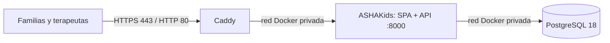

# Despliegue de ASHAKids en AWS EC2 con Docker

## Arquitectura implementada

El despliegue usa `docker-compose.ec2.yml`, independiente del Compose local:

- **Caddy** publica los puertos 80/443, enruta al servidor web/API y gestiona HTTPS automático para un dominio propio.
- **ASHAKids** sirve la SPA y la API Express por el puerto interno 8000. El puerto no queda publicado directamente en EC2.
- **PostgreSQL 18** queda en la red Docker privada, con almacenamiento persistente y un usuario de aplicación restringido.
- El esquema y los datos iniciales se cargan desde `docker/init.sql` cuando se crea un volumen vacío. El usuario de la aplicación se configura con `docker/20-create-app-user.sql`.



## Requisitos previos

1. Confirma en **AWS Settings → Projects → Overview → Additional Info → Region** la región asignada al proyecto. Usa esa región para la instancia y sus recursos regionales.
2. Revisa el plan y gasto en **AWS Settings → Billing**. Una EC2 activa, EBS y la IPv4 pública pueden generar cargos. `t3.small` ofrece 2 GiB de memoria; `t3.micro` reduce capacidad y puede quedarse corta al compilar.
3. Crea Ubuntu Server 22.04/24.04 LTS x86_64, EBS gp3 cifrado de 20 GiB y un par `.pem` para SSH.
4. En el Security Group abre TCP 22 solo desde tu IP, y TCP 80/443 desde Internet. No abras 5432 ni 8000.
5. Usa un dominio que controles. Después de crear EC2, crea un registro DNS A del dominio hacia la IPv4 pública de esa instancia. Caddy necesita el DNS correcto y el acceso entrante a 80/443 para emitir el certificado.

## Publicar el código

Los cambios locales deben estar en GitHub en la rama indicada antes de clonar en EC2. Ya conectado por SSH a la instancia, instala Git y clona la rama publicada:

```bash
sudo apt-get update && sudo apt-get install -y git
git clone -b feat/sroman https://github.com/sromansilva/ashakids-platform.git
cd ashakids-platform
chmod +x scripts/deploy-ec2.sh
./scripts/deploy-ec2.sh
```

El script instala Docker/Compose si hacen falta, solicita el dominio, genera dos secretos aleatorios, guarda `.env.ec2` con permisos privados, verifica el DNS y valida la configuración de producción antes de levantar los servicios. Si preparas `.env.ec2` manualmente, parte de `deploy/ec2.env.example`; no subas ese archivo con secretos a Git.

El script usa explícitamente:

```bash
docker compose --project-name ashakids-ec2 \
  --env-file .env.ec2 \
  --file docker-compose.ec2.yml \
  up --detach --build --wait
```

## Verificación

```bash
sudo docker compose --project-name ashakids-ec2 --env-file .env.ec2 --file docker-compose.ec2.yml ps
sudo docker compose --project-name ashakids-ec2 --env-file .env.ec2 --file docker-compose.ec2.yml logs --tail=100 app caddy postgres
curl -fsS "https://$(grep '^APP_DOMAIN=' .env.ec2 | cut -d= -f2)/health/ready"
```

Confirma la web y el inicio/cierre de sesión por HTTPS. Prueba autorización por rol, separación de datos, respaldo y restauración antes de almacenar información real. El `init.sql` incluido carga información ficticia de demostración; reemplázala antes de abrir el sitio al público. Los scripts de inicialización de PostgreSQL no vuelven a correr si el volumen ya contiene datos.

## Actualizar la aplicación

Desde la carpeta del repositorio en EC2:

```bash
git fetch origin
git checkout feat/sroman
git pull --ff-only origin feat/sroman
sudo docker compose --project-name ashakids-ec2 --env-file .env.ec2 --file docker-compose.ec2.yml up --detach --build --wait
```

Conserva `.env.ec2` y el volumen PostgreSQL durante las actualizaciones. No uses `down --volumes` en una instancia que contenga datos que deban conservarse.
